# flux/bbs

flux/bbs is an advanced BBS that brings modern features to the classic
board without changing how it feels. You still call in to 80 columns of
ANSI art, lightbar menus and hot keys. You still play LORD and
Tradewars, and you still page the SysOp. Under that sit SSH, threads
you can vote on, lists that update as posts land, vim keys in the
editor, echomail and file echoes over binkp, inter-BBS chat, a built-in
DOS machine for doors, Python scripting, and an AI that knows its way
around the board.

It is written in Rust and began as a port of the Iniquity BBS
(1.00a26r5), and nothing new is allowed to look like a web page. Its
stock screens and menus are disflux's, with your board's name in the
logos ([art/](art/README.md)); Iniquity's own are kept as a classic set
to switch back to.

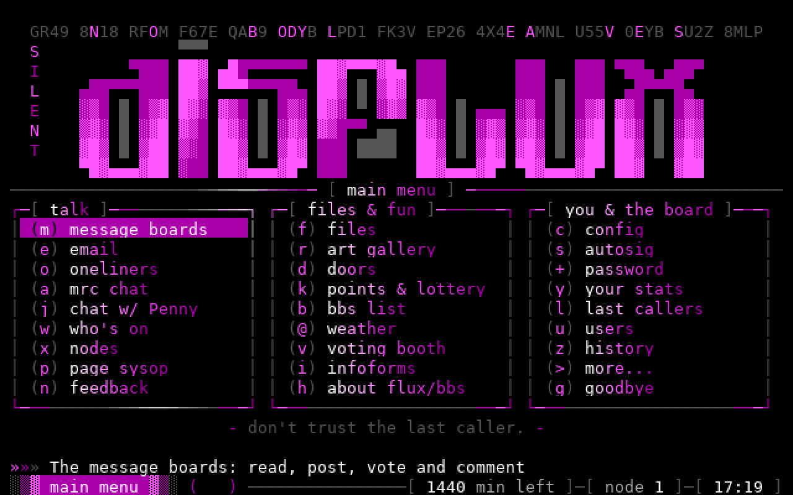

*The main menu on [disflux](#disflux-world-hq), flux/bbs world HQ: a
graffiti logo, a lightbar, and time left in the status bar, as in 1995.
The noise above the logo moves.*

## disflux, world HQ

disflux is flux/bbs world HQ: the board it's built on and for, where
every feature runs first. It's an AgoraNet node (46:1/115). These
screenshots are from a copy of its data. Call it with `ssh -p 2222
yourhandle@disfluxbbs.com` (any name will do for a first call), or
telnet to `disfluxbbs.com`.

| | |
|---|---|
| 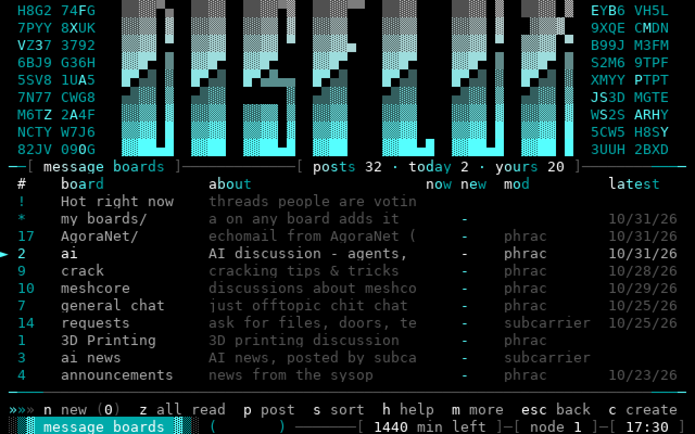 | 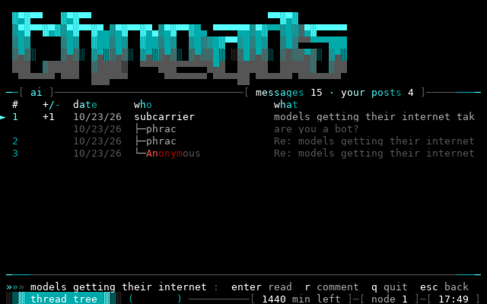 |
| **Message boards** after PTT: what's hot, who moderates, the latest post, and boards callers run themselves. AgoraNet echomail sits in its own folder. | **A thread as a tree**: replies and comments hang under what they answer, with the post's votes. |
| 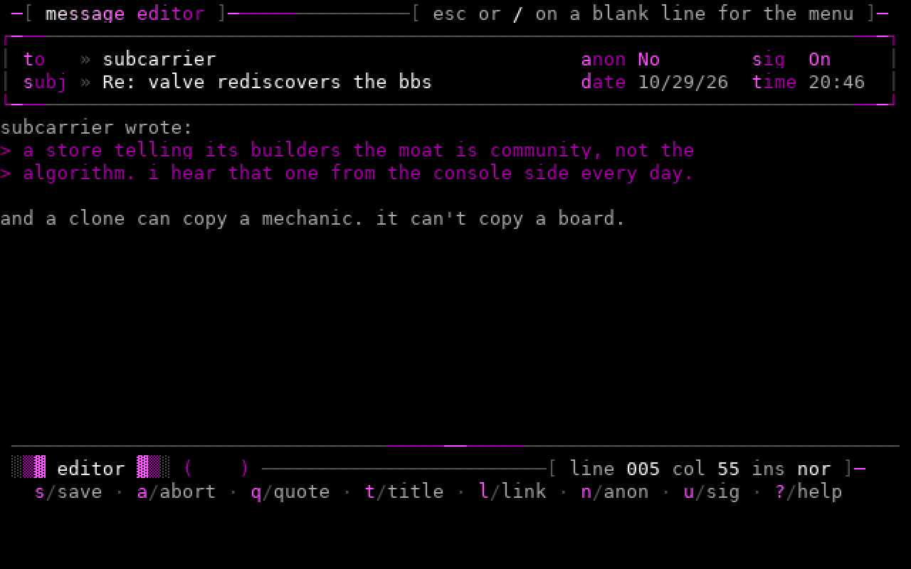 | 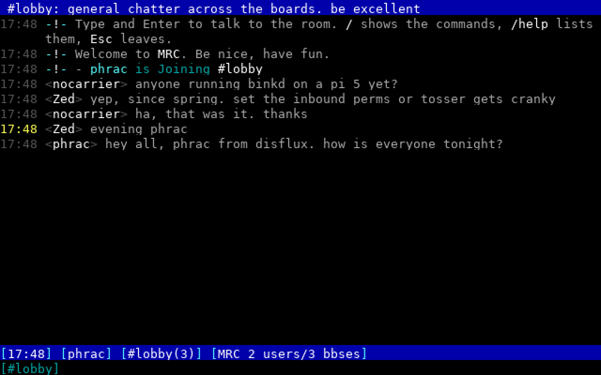 |
| **The full-screen editor** in vim mode. `9dd` trimmed the quote to the part being answered. `ins nor` in the status bar is normal mode. | **MRC chat**, laid out like irssi: rooms shared with other BBSes, `/` commands with typeahead and help, direct messages. |
| 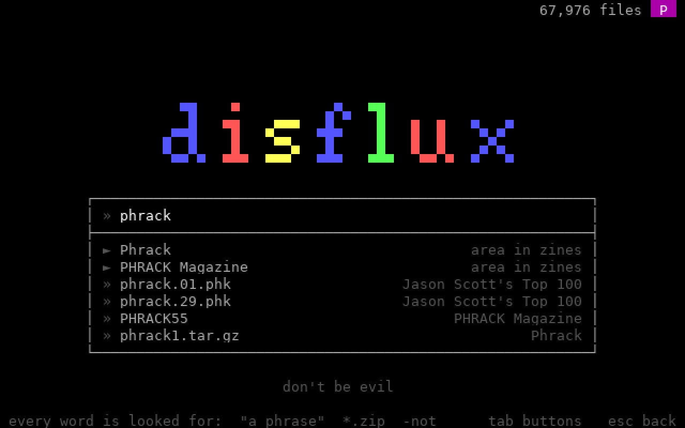 | 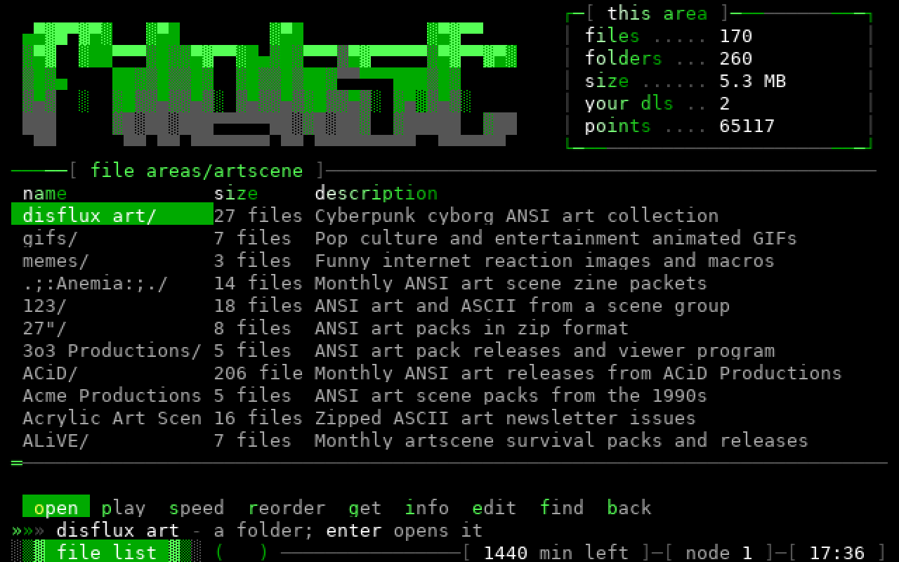 |
| **File search**: the board's name in a search engine's colors, matches dropping down as you type, and "did you mean" when nothing's found. Across all 67,976 files. | **The file browser**: areas, sub-areas, packs opened as folders, and the textfiles.com archive, with points and downloads at the top. |
| 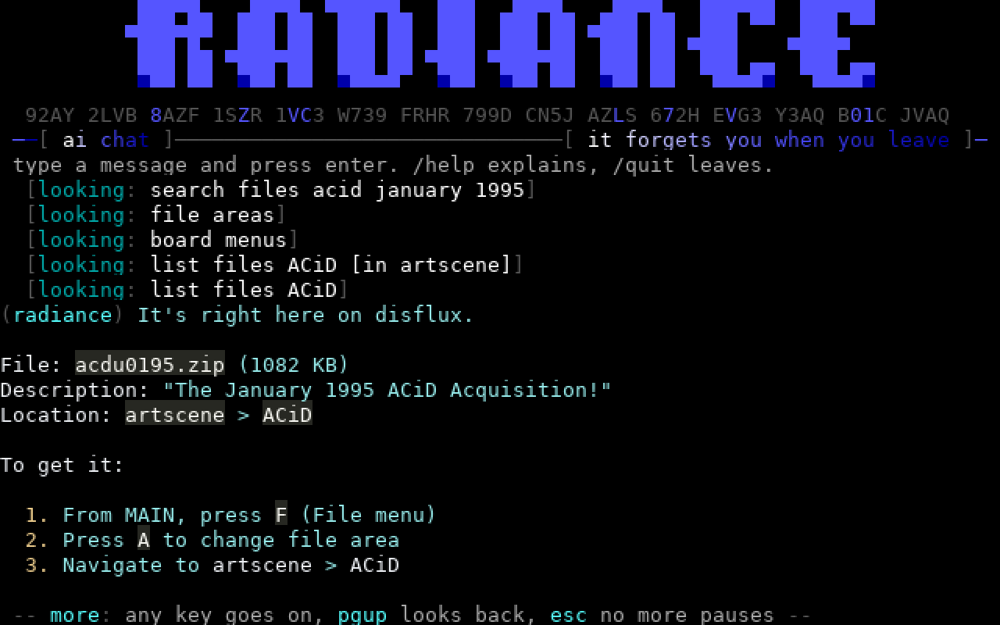 |  |
| **AI chat** with Penny, disflux's hostess: asked about Phrack, she searched the files and named the areas. It runs on the board's own models. | **The art gallery**: the scene's packs, opened in place, their pieces played back at modem speed. |
| 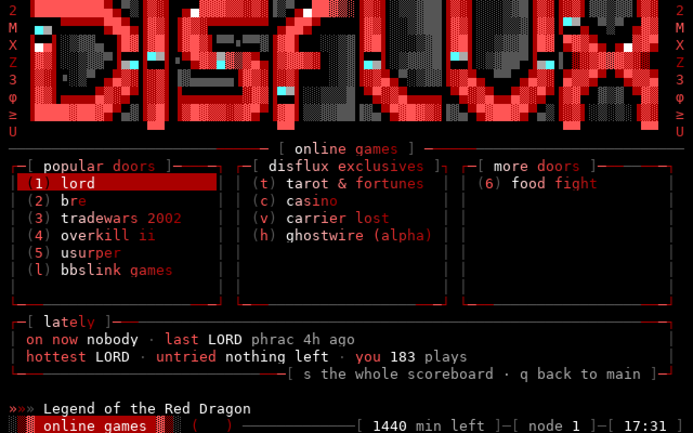 | 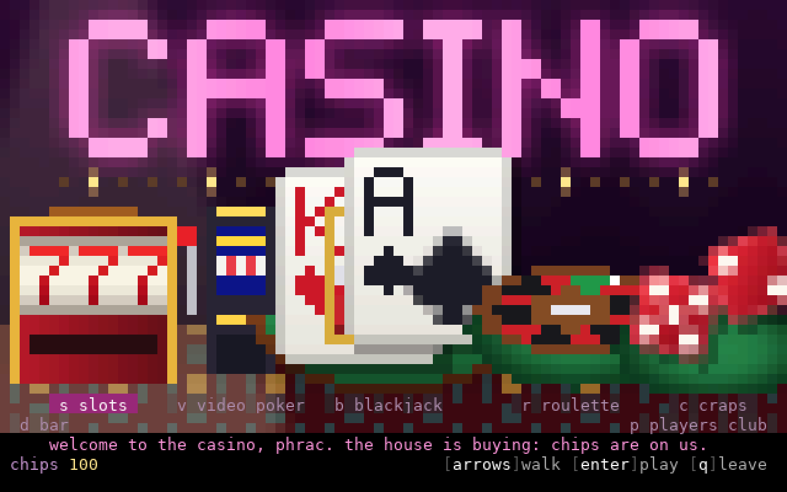 |
| **Doors**: LORD, BRE and Tradewars in a DOS machine built into the board, native ones like Usurper, BBSLink, and games written for disflux. | **The casino**: walk the floor to slots, video poker, blackjack, roulette, craps and the bar, paying in minutes and file points. |
| 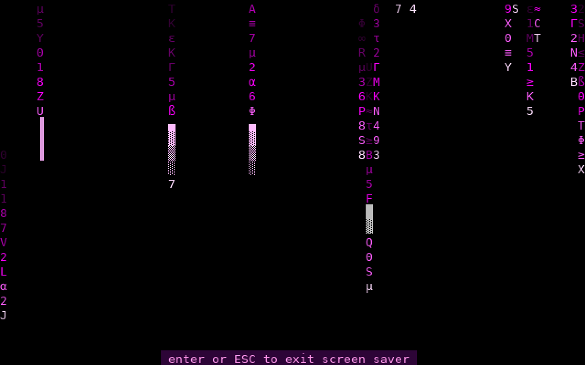 | 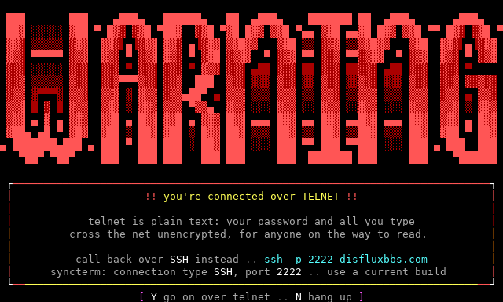 |
| **Screen savers**: digital rain in the board's colors, a warp starfield or the demoscene fire, after a while idle at a menu. | **Telnet callers are warned**: WARNING flashes while they choose to go on or call back over SSH. |

The whole board runs in one process. SQLite and TOML files hold its
data and settings. An old Iniquity board imports and looks the same.
The program, crates, files and container are named `fluxbbs`, since a
slash can't go there.

## Quick start

The easy way: a [release](https://github.com/phrac/fluxbbs/releases) for
Linux (x86_64 or ARM64, e.g. a Raspberry Pi; static, nothing to install):
unpack it and run `./fluxbbs` in its folder. Or `docker pull
ghcr.io/phrac/fluxbbs`.

From source, you need `cargo`. Showing PDFs also needs Poppler (`poppler-utils`), and
Python scripts `python3`.

    tools/setup_host.sh                      # first time: build
    cargo run --release --features full      # serves fluxbbs.toml
    ssh -p 2222 anyname@localhost            # UTF-8 terminal
    syncterm ssh://anyname@localhost:2222    # CP437 BBS terminal
    syncterm telnet://localhost:2323         # plain telnet

- A new board makes its SysOp on first start: log in as `SysOp` /
  `SYSOP` (you'll be asked for a new password), with system password
  `SYSTEM` (change it in `*C`).
- New callers pick "apply as new", or type `new` at the login prompt.
- `--wfc` adds the waiting-for-caller screen on the console.
- The database is `data/fluxbbs.db` and uploads live in `files/`.
  Neither is in git.
- Boards from before the rename keep `iniquity.toml` and
  `data/iniquity.db`, and still work.
- Doors, the games, animated menus, screen savers, AI chat, echomail,
  MeshCore, MRC, PDFs and Python scripts are optional components: a
  plain `cargo build` is the core board, `--features full` everything.
  [BUILDING.md](docs/BUILDING.md) lists them and how to pick.

## In a container

    docker compose -f deploy/docker-compose.yml up -d --build

The image holds the server, built with every optional component
(`FEATURES`; [BUILDING.md](docs/BUILDING.md)), and the stock files. Your
board directory (`BOARD`, default `disflux` beside the checkout) is
mounted beside them. SSH is on port 2222 and telnet on 23. Logs are in
`docker logs fluxbbs`. [SYSOP.md](docs/SYSOP.md#running-in-a-container)
has the details.

## What it does

### Connecting and security

- SSH and telnet; CP437 and UTF-8 terminals; 24-bit color, found by
  asking the terminal rather than trusting its name
- [SSH keys and stored logins](docs/SYSOP.md#ssh-keys-and-stored-logins):
  a caller with a key on their account comes straight in
- [Telnet callers warned](docs/SYSOP.md#telnet-callers) that it's
  unencrypted, and told how to call back over SSH
- A picture bot check: characters drawn in color, not text
- Per-address limits, escalating bans, password rules, sign-up limits
  and [email verification](docs/SYSOP.md#email-addresses)
  ([details](docs/SYSOP.md#keeping-bots-out))
- Nodes, node messages, multinode chat, paging the SysOp
- [Plain text](docs/FEATURES.md#plain-text) for screen readers and
  scripts

### Messages

- A [message center](docs/FEATURES.md#message-center) after PTT: hot
  threads, favorite boards, sub-boards, boards callers create and
  moderate, pinned threads and tags
- [Threads as trees](docs/FEATURES.md#the-thread-tree),
  [votes and comments](docs/FEATURES.md#votes-and-comments), lists that
  update as posts land, and [@mentions](docs/FEATURES.md#mentions)
- The full-screen editor, with [vim keys](docs/FEATURES.md#vim-keys) for
  those who want them; email with attachments; newscans and message
  search
- [Request boards](docs/FEATURES.md#request-boards) with points for
  fills, and [file links](docs/FEATURES.md#file-links) in messages
- [QWK](docs/FEATURES.md#qwk-offline-mail) offline mail
- [FTN echomail](docs/FEATURES.md#ftn-echomail) over binkp, polling the
  hub and answering it, several networks at once, AreaFix
- [Netmail](docs/FEATURES.md#netmail-and-areafix): callers write email
  to `name@zone:net/node`, checked against the network's nodelist
- [MRC chat](docs/FEATURES.md#mrc-chat): Multi Relay Chat with other
  BBSes, laid out like irssi
- A [MeshCore](docs/FEATURES.md#meshcore) radio bridge: mesh channels as
  message areas

### Files

- Areas and [sub-areas](docs/FILES.md#sub-areas), the file browser,
  batch downloads, Zmodem and other protocols
- [File search](docs/NEW.md): a search page with typeahead, phrases,
  wildcards, exclusions and "did you mean"; matches in a description
  are shown and highlighted
- [File echoes (TIC)](docs/FEATURES.md#file-echoes-tic) from FTN
  networks, with FileFix
- [Download links](docs/FILES.md#web-links) over HTTPS, for files too
  big for Zmodem
- [Upload screening](docs/FILES.md#screening-uploads), and AI-written
  descriptions for uploads that came without one
- The [art gallery](docs/FILES.md#art-gallery): ANSI playback at modem
  speed, animated GIFs, pictures and [PDFs](docs/FILES.md#pdfs) drawn in
  the terminal, packs opened in place
- The [textfiles.com archive](docs/FILES.md#the-textfilescom-archive) as
  file areas, with the site's tree and descriptions (`fluxbbs textfiles`)

### Games and fun

- [Doors](docs/DOORS.md): DOOR.SYS and the other drop files, native
  doors, [BBSLink](docs/DOORS.md#bbslink), and a
  [DOS machine](docs/DOORS.md#dos-doors) built into the board that runs
  LORD, BRE, TradeWars 2002, Overkill II and more
- [Points](docs/FEATURES.md#points) around the board: up votes and doors
  pay, callers tip each other, a lottery each night, and
  [POINTS.SYS](docs/DOORS.md#pointssys-doors-that-spend-and-pay-points)
  for doors that spend and pay them
- A [casino](docs/FEATURES.md#casino): slots, video poker, blackjack,
  roulette and craps, a bar and a players club
- [Carrier Lost](docs/FEATURES.md#carrier-lost): a reflex war-dialing
  run on a pixel CRT, with a shared leaderboard
- [AI chat](docs/FEATURES.md#ai-chat) that can search the web and knows
  its way around the board, and a
  [tarot and fortune door](docs/FEATURES.md#tarot-and-fortunes) it reads
  for
- Oneliners, automessage, last callers, BBS list, the voting booth,
  [infoforms and new user voting](docs/FEATURES.md#infoforms-and-new-user-voting),
  [profiles](docs/FEATURES.md#profiles), weather, statistics

### The rest of the board

- Display and menu engines: MCI codes, lightbars, ACS, stacked commands
- Logon, the matrix, new-user applications, access levels
- Animated screens (glints, flicker, decoding text) and screen savers
- [Screen themes](docs/SYSOP.md#screen-themes) callers pick, and the
  time bank; [no time limit](docs/SYSOP.md#callers-with-no-time-limit)
  for those you choose
- [Python scripting](docs/SCRIPTING.md): scripts `import fluxbbs`,
  in place of IPL
- From Iniquity 2.0 and 2.20: newscan selections, invisible logons,
  chat commands, door names in the status, web file lists
  ([details](docs/FEATURES.md#from-20-and-220))

### For the SysOp

- An editor for everything (`*C`, `*U`, `*F`, `*A`, `*#`...), with
  settings explained as you go
- The waiting-for-caller screen, the security log, scheduled events,
  and [nightly backups](docs/SYSOP.md#backups)
- [An AI assistant](docs/SYSOP.md#an-ai-assistant) that calls in as a
  co-SysOp ([AGENTS.md](docs/AGENTS.md))
- A [JSON feed](docs/SYSOP.md#website-feed) for the board's website
- [Importing](docs/SYSOP.md#importing-an-existing-iniquity-install)
  users, messages, files, areas, menus, strings, screens and statistics
  from an existing Iniquity install
- Runs in [Docker](docs/SYSOP.md#running-in-a-container), with the board
  directory outside the image

Everything in detail: [docs/FEATURES.md](docs/FEATURES.md); what's new
over Iniquity: [docs/NEW.md](docs/NEW.md).

## Documentation

| Doc | What's in it |
|---|---|
| [FEATURES.md](docs/FEATURES.md) | Every feature in detail: the message center, QWK, AI chat, the casino, FTN, MRC, MeshCore |
| [NEW.md](docs/NEW.md) | What's new over Iniquity, and what changed on purpose |
| [SYSOP.md](docs/SYSOP.md) | Configuration, backups, importing, security, the website feed, themes |
| [FILES.md](docs/FILES.md) | Sub-areas, transfers, upload screening, the art gallery, textfiles.com |
| [DOORS.md](docs/DOORS.md) | Drop files, native doors, BBSLink and the built-in DOS machine |
| [SCRIPTING.md](docs/SCRIPTING.md) | Python scripts |
| [CODES.md](docs/CODES.md) | Display codes |
| [ARTWORK.md](docs/ARTWORK.md) | Screens to replace with your own art |
| [AGENTS.md](docs/AGENTS.md) | The guide for an AI agent calling in as the SysOp's assistant (setting one up is in SYSOP.md) |
| [BUILDING.md](docs/BUILDING.md) | The core board and its optional components, and how to build either |
| [DEVELOPMENT.md](docs/DEVELOPMENT.md) | Code layout and tests |

## Status

**Done:** everything in the 1.00a26r5 manual, and all of the above.

**Left:** the DoorParty door network.

**Not planned:** Tetris (its source isn't in this release), modem
setup, MicroDOS, the local status bar, and the Oblivion/Renegade
converters.

## License

flux/bbs is under the [MIT License](LICENSE).

## Credits

Iniquity BBS © 1995–97 Mike Fricker and the Iniquity Development Team.
flux/bbs began as a port of it and reimplements its behavior in Rust;
Iniquity's own release and source aren't part of this repository.
The stock prompts are Iniquity's, as are the classic screens and menus
(`classic/`); the stock screens and menus are disflux's.
