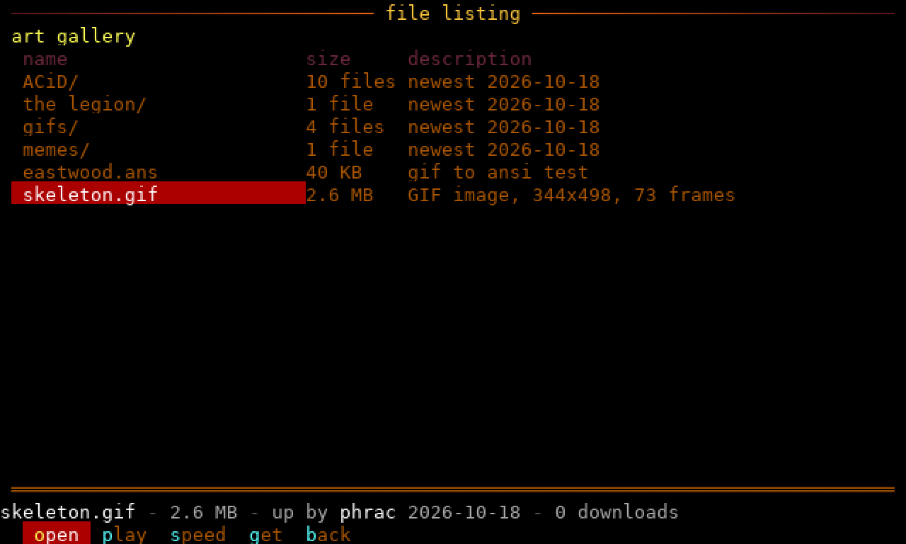
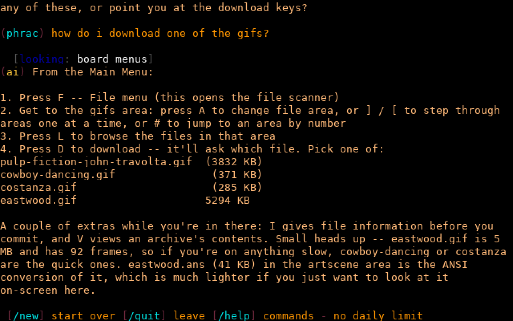

# Iniquity BBS, in Rust

A port of **Iniquity** (Mike Fricker and the Iniquity Development Team,
1995–97, Turbo Pascal, 1.00a26r5) for running a BBS on today's internet.

SSH and telnet replace the modems, SQLite and TOML replace the `.DAT`
files, and it all runs in one process. The stock screens, menus and
prompts are kept, so an old Iniquity board imports and looks the same.

## Quick start

    tools/setup_host.sh                      # first time: stock data, build
    cargo run --release                      # serves iniquity.toml
    ssh -p 2222 anyname@localhost            # UTF-8 terminal
    syncterm ssh://anyname@localhost:2222    # CP437 BBS terminal
    syncterm telnet://localhost:2323         # plain telnet

Log in as `SysOp` / `SYSOP` (system password `SYSTEM`), and change both.
New callers pick "apply as new" or type `new` at the login prompt.

`--wfc` adds the waiting-for-caller screen on the console. The database
is `data/iniquity.db` and uploads live in `files/`; neither is in git.

## In a container

    docker compose -f deploy/docker-compose.yml up -d --build

The image holds the server and the stock files; your board directory
(`BOARD`, default `~/code/disflux_bbs`) is mounted beside them. SSH is
on port 2222, telnet on 23, logs in `docker logs iniquity`.

## What's done

**Connections:** SSH and telnet, CP437 and UTF-8 terminals, 24-bit
colour, nodes, node messages, multinode chat, paging the SysOp.

**Keeping bots out:** a key-combination bot check, per-address limits,
escalating bans, password rules and sign-up limits.

**The board**
- The display and menu engines: MCI codes, lightbars, ACS, stacked
  commands
- Logon, the matrix, new-user applications, access levels
- Messages: areas, conferences, the full-screen editor, newscans,
  email, attachments
- Files: areas and sub-areas, the lister, batch downloads, Zmodem,
  upload screening
- The art gallery, with ANSI playback and animated GIFs
- Oneliners, automessage, last callers, BBS list, statistics
- Infoforms and new user voting
- The time bank
- Screen themes
- Lua scripting
- QWK offline mail
- Doors, native and DOS (a built-in DOS machine)
- AI chat that can search the web and knows its way around the board
- A JSON feed for the board's website

**SysOp tools:** an editor for everything (`*C`, `*U`, `*F`, `*A`,
`*#`...), the waiting-for-caller screen, the security log, scheduled
events.

**Importing:** users, messages, files, areas, menus, strings, screens
and statistics from an existing install.

All of it in detail: [docs/FEATURES.md](docs/FEATURES.md).

## What's left to port

| Feature | Original | Notes |
|---|---|---|
| Echomail / netmail | echomail.pas, INIQMAIL.PAS | FidoNet-style networking; would need a mailer/tosser bridge today. |

**Not planned:** Tetris (its source isn't in this release), modem
setup, MicroDOS, the local status bar, and the Oblivion/Renegade
converters.

## Documentation

| | |
|---|---|
| [FEATURES.md](docs/FEATURES.md) | Everything the port does, QWK, infoforms, AI chat |
| [SYSOP.md](docs/SYSOP.md) | Configuration, importing, security, the website feed, themes |
| [FILES.md](docs/FILES.md) | Sub-areas, transfers, upload screening, the art gallery |
| [DOORS.md](docs/DOORS.md) | Native doors and the built-in DOS machine |
| [SCRIPTING.md](docs/SCRIPTING.md) | Lua scripts |
| [CODES.md](docs/CODES.md) | Display codes |
| [ARTWORK.md](docs/ARTWORK.md) | Screens to replace with your own art |
| [DEVELOPMENT.md](docs/DEVELOPMENT.md) | Code layout and tests |

## Credits

Iniquity BBS © 1995–97 Mike Fricker and the Iniquity Development Team.
This port reimplements its behaviour in Rust; the stock screens, menus
and strings are the original's.
