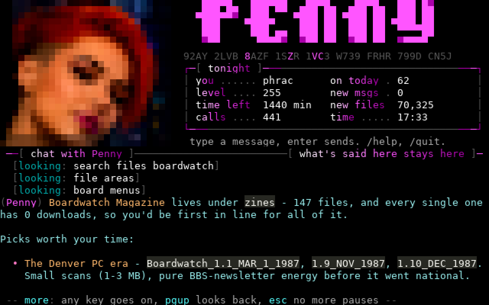

# Features

What flux/bbs does, area by area, and how to use and set up each part.
The [README](../README.md) has the short list, and [NEW.md](NEW.md)
says what's new over Iniquity.

**Contents**

- [In detail](#in-detail): connections, keeping bots out, logon, menus
  and screens, messages, files, profiles, doors, SysOp tools, importing
- [QWK offline mail](#qwk-offline-mail)
- [Infoforms and new user voting](#infoforms-and-new-user-voting)
- [AI chat](#ai-chat)
- [Achievements](#achievements) and [top lists](#top-lists)
- [ANSI art from a prompt](#ansi-art-from-a-prompt)
- [Message center](#message-center)
- [MeshCore](#meshcore)
- [FTN echomail](#ftn-echomail)
- [From 2.0 and 2.20](#from-20-and-220)
- [Not planned](#not-planned)

## In detail

### Connections

#### SSH

flux/bbs speaks SSH (through russh), including the older algorithms
that SyncTERM's cryptlib needs.

A caller can log in without the bot check or login prompts in two ways:

- With an SSH key kept on their account (`UK`, or `k` in user config).
- With the account's password as the SSH password (a terminal's stored
  login).

[SYSOP.md](SYSOP.md) has the details.

#### Telnet

Telnet supports binary mode, server echo, window size (NAWS) and
terminal type. Zmodem works over it.

#### Character sets and color

- CP437 for BBS terminals.
- UTF-8 for everything else, with DOS's wrap and clear behavior.
- aixterm bright colors and iCE backgrounds.
- 256-color and 24-bit color art passes through.

#### Clickable links

URLs (`http`, `https`, `ftp`, `ftps`, `gopher`, `telnet`, `ssh` and
`mailto:`) go out as clickable links (OSC 8) where the terminal takes
them:

- in messages, in both readers, and their comments;
- in file descriptions: the lister, the file info screen, the file
  browser's popups;
- in the text viewer (text, NFO, Markdown, web pages, code) and the
  reading room;
- in the short-lived HTTPS download links the file area gives (`W`).

A URL cut over lines to fit the screen is one link, and one cut short
in a list still goes to the whole address. The links take no room on
screen; what's stored, quoted, exported (QWK, FTN) and edited is the
text as it was.

Which terminals get them, with "links" in user configuration on auto
(`o` on the user config screen):

| Terminal | Links |
|---|---|
| CTerm (SyncTERM) | when it answers yes to `ESC[=6n`, asked at logon |
| IcyTerm | yes, known by its device attributes |
| UTF-8, TERM in `[terminal] link_terms` (`xterm*`, `foot*`, `wezterm`, `alacritty`, `*ghostty`, `konsole*`, `vte*`, `tmux*`...) | yes |
| anything else (DOS terminals, NetRunner, an unknown CP437 terminal) | no: an OSC it doesn't know could show as text |
| plain text | never |

On or off overrides auto (plain text still gets none). Only printable
ASCII goes into a link, so text can't slip codes of its own into one, and
URLs over 2,048 characters stay text.

#### Nodes

Each caller is on a node. Nodes give you who's online, node messages,
broadcasts and multinode chat.

#### Paging the SysOp

`CP` (or `>C` from the matrix) pages the SysOp. The page goes to a node
where a SysOp is logged in, and they're asked, wherever they are,
whether to chat. The two then chat on a split screen (CHATMODE.ANS),
each keystroke sent as it's typed.

| Type | To |
|---|---|
| `/q` | end the chat |
| `/bye` | (SysOp) hang the caller up |
| `/cls` | clear the windows |
| `/?` | show CHATHELP |

`[chat]` in `fluxbbs.toml` sets the chat hours, the override ACS and
password, the pages per call and how long a page lasts. Outside the
hours, or with no SysOp online, the caller is offered email instead.

#### Feedback from the matrix

`>F` (f on the stock matrix) lets someone who hasn't logged in leave
the SysOp a note: any name they like, a way to reach them if they want
an answer, a subject, and the text in the usual editor. It lands in
the SysOp's email (user 1, or whoever the parameter names) from
"*name* (visitor)", tied to no account, so it can't pass for a caller;
its first lines say so and give the caller's address, how they came
(SSH or telnet) and their node. Replying to it says it can't be
answered instead. A SysOp who's on is told it came, as with a post on
a board they follow; otherwise it waits in their email like any other.
When a page from the matrix finds no SysOp, the caller is offered a
note instead (`[chat] ask_email`).

It comes after the bot check, and the board's per-address limits and
bans hold as for any call. On top of them: two notes a day from one
address and twenty from everyone, a name of 30 characters, a way to
reach them of 60, a subject of 40, and the first 100 lines of the
text. The user list's handles aren't offered in the editor (`@`).
Logged in, `>F` is plain email (`EE`). `*C`, Features, P turns it off.

### Keeping bots out

#### The bot check

Every caller passes a bot check before anything else, on SSH and
telnet. Three big characters are drawn with background color in a
field of noise, and the caller types them. A person reads them; a
script reading the text sees only noise. The key-combination check is
still there as an option. See [SYSOP.md](SYSOP.md).

#### Limits and bans

- Connection limits per address.
- Bans for repeated failures, doubling each time, up to a day; the
  fifth, or one a bot keeps calling back into, is for good.
- Allow and deny lists.
- A short idle limit before login.

Bans and failures are kept in the database, so bans survive a restart.
At logon, SysOps are told how many failures and bans there have been
since their last call. `*G` lists them and lifts bans.

A SysOp locked out of their own board can run `fluxbbs unban
ADDRESS|all` from the shell.

### Logon

- The matrix menu, login and system password.
- The new-user application. Each personal question can be switched
  off, handles are kept as typed, and the NEWCFG screen lets the caller
  check their entries afterwards.
- Access levels and daily limits.
- A recheck every N calls: the caller is asked their birth date, or the
  last four digits of their phone number, again. Set it in `*C`, Access
  and Logon. These are the manual's "calls before check" options,
  rebuilt from the manual.

What happens after login is set with `*O`; see
[Logon sequence](#logon-sequence-o).

### Menus and screens

#### The display engine

| Code | Does |
|---|---|
| `\|XX` | colors and controls |
| `%XX` | MCI codes |
| `@`, `&` | positioning |
| `{`, `}` | limits and padding |
| `~XX` | fields |

The engine also shows repeat screens (TOP/MID/HIL/BOT) and picks random
and day-of-week variants of a screen. [CODES.md](CODES.md) lists the
codes.

#### The menu engine

- Hot keys, and `/` and `//` commands.
- `#`: an area number typed at the prompt, for `M#` and `F#`.
- FIRSTCMD, stacked commands, and gosub/return.
- Generic and lightbar menus.
- ACS expressions, passwords, fallbacks and command help.

#### Lightbar menus

- They take their commands' keys too: hot keys, `/X`, and digits for
  `#`, typed on the help line.
- The arrows go by where options sit on screen, so a grid of options
  works.
- They hold up to 29 options.

#### Screen themes

A theme is a directory of screens that replaces the stock ones (the
original's text libraries). Callers pick theirs with `UT`.

#### Scripting

Python takes the place of IPL. `-X name` and `%!name` run
`scripts/name.py`, which imports `fluxbbs`, the API for output, input,
the user record, menu commands and stored values. See
[SCRIPTING.md](SCRIPTING.md).

### Messages

The classic message system has areas and conferences, the reader,
posting and replying, quoting, the full-screen editor, newscans and
mandatory messages, email and auto-signatures. The
[message center](#message-center) is the newer way to read.

#### Quoting

A quote in a reply opens with who wrote it, then each line with `> `
(a quote of a quote, `>>`):

```
phrac wrote:
> test message - use this area for general chat
```

The original put the author's initials in front (`P> `), which said too
little. `MsgQuoteHead` is the opening line; it's kept in the message,
so it's plain. Autoquote takes the end of the message, up to Max quote
lines (`*C`, messages M; 11 to start); 0 quotes all of it.

#### Editing your posts

Callers can edit what they've posted, as on reddit, but what they
posted stays. `e` in a reader on your own message opens the editor
empty ("what you posted stays as it was; this is added under it"); what
you write there is added at the end, under a dated line:

```
works for me, nice board

[edit 10/24/26 22:11]
also: try the doors menu
```

The signature stays at the very end. `MsgEditMark` is the dated line;
it's kept in the message, so it's plain text. Echomail already sent
doesn't change. A moderator (or co-SysOp) editing someone else's post
still gets the whole text, to clean it up.

#### Taking it back

Everyone posts something they regret. `d` on your own post (in either
reader, in any area but email) offers a way back, kindly but on the
record:

- **Take it back.** Within `take_back_minutes` of posting (15 to start),
  while nobody has commented, voted or replied, it goes as if you never
  posted it.
- **Retract it.** Everyone else sees "[retracted by its author
  10/24/26]" in its place, with the comments and votes still under it
  so the thread makes sense. You and the moderators still see what it
  said. `d` again undoes it.
- **Burn it.** Gone for good: its text, the comments and votes under
  it, any attachment, and what a retraction kept. It costs
  `burn_points` file points (25 to start), a small sacrifice you can
  earn back; on a board without file points it's free. It asks twice.

Nobody is told, and nothing says who took what back beyond the
placeholder. A taken-back or burned post leaves a deleted stub
("[burned by its author ...]") that moderators see. On an echomail area, copies already sent to other boards stay
there, and it says so. Both settings are in `[messages]`, and in `*C`,
Caller Boards ("Take-back minutes", "Burn points"). Moderators deleting
someone else's post still use the usual delete.

#### The trash

A deleted post (and a burned one's stub) goes to the trash, with when
and by whom. `D` on it again in the reader brings it back, and `*-` on
the SysOp menu lists the whole trash, newest first, with the days each
has left: a number, then `R` restores it, `V` reads it, `P` purges it
now. After `keep_deleted_days` (`[messages]`, 30 to start; 0 keeps them)
the board purges it for good, with its comments' links, pins, pushes
and attachment, checking at startup and then daily, so there's no event
to set up. In the original, deleted messages stayed till the SysOp
packed the area (`maPackArea`). Deleted email doesn't wait: it's gone at
once.

#### Editor hints

As the full-screen editor opens, its prompt row shows one of the
board's mottos, at random, until the first key: "the internet never
forgets", "never forget", "every word goes on the record", or that `n`
on the main menu tells the SysOp what the board should do. They're the
strings `FsHint1`, `FsHint2`... (`*E` changes them; add more by number,
or blank one to drop it).

#### Live updates

A post lands on the board, from a caller, echomail or QWK, and everyone
online sees it without doing anything:

- **On a board list or thread list**, the list draws itself again with
  the post in it, the bar where it was.
- **If the board is in your "my boards"** (or a folder of them is, such
  as AgoraNet/), a line says so: `» new on General chat: the subject by
  who`. It goes in the help line of a list or a lightbar menu, and
  under the screen elsewhere. Not for your own posts, private mail, or
  boards you can't read. The words are `NewPostNotice` (`*E`).

#### Vim keys

A caller who sets "editor keys" to vim in their configuration (`UC`,
field `Z`; `i` on disflux's screen) gets vim in the full-screen editor
(`vim.rs`). Like vim, it opens in normal mode, and Esc there stays
there. The insert flag (`~IN`) shows the mode (`nor`, `ins`, `rep`,
`vis`), and when the screen's prompt row isn't one of the text's, it
says `-- INSERT --`, `-- VISUAL --`, `recording @q` as vim does.

- **Modes:** `i a I A o O gi gI` insert, `R` replace (Backspace puts back
  what was there), `v` and `V` visual (characters, lines; `o` swaps
  ends, `gv` selects again), Esc back to normal.
- **Moves:** `h j k l` (and the arrows), `w b e ge W B E gE`, `0 ^ $ g_
  |`, `gg G` (`5G`), `{ }`, `%`, `f t F T ; ,`, `H M L`, `+ - _ Enter`,
  Ctrl-D/U/F/B, Ctrl-E/Y, marks (`ma`, `'a`, `` `a ``, `''`), `/ ? n N *
  #` (vim's patterns, less groups and `\|`).
- **Operators** `d c y > < g~ gu gU` with any move or a text object
  (`iw aw iW aW i" a" i' a' i( a( ib i[ i{ iB i< ip ap`), doubled for
  lines (`dd 3dd yy >> gUU`): `dap` drops a quoted paragraph whole. The
  odd cases are vim's: `cw` is `ce`, `dw` on a line's last word stops
  there, and `d}` from a line's start takes whole lines.
- **Small commands:** `x X s S r D C Y J gJ ~ p P`, Ctrl-A/Ctrl-X add to
  a number, `u` and Ctrl-R undo and redo, `.` repeats the last change
  (with a new count if one's typed), `q` and `@` record and play macros.
- **Registers:** `"a` to `"z` (`"A` adds), `"0` the last yank, `"1` to
  `"9` the last deletes of lines, `"-` small ones, `"_` none.
- **Insert mode:** Ctrl-W, Ctrl-U, Ctrl-T/Ctrl-D (shift), Ctrl-Y/Ctrl-E
  (the character above or below), Ctrl-R and a register, Ctrl-O for one
  normal-mode command; Tab still completes an `@handle`.
- **The command line** (`:`), with ranges (`.`, `$`, `%`, `12`, `'a`,
  `'<,'>`, `+N`, `-N`): `:w`, `:wq`, `:x` and `ZZ` save (posting is
  saving and leaving at once), `:q` asks before throwing the message
  away, `:q!` and `ZQ` don't; `:12` goes to line 12; `:s/old/new/gi`,
  `:&`, `:d`, `:y`, `:>`, `:<`, `:j`, `:m`, `:t`, `:u`, `:red`, `:noh`,
  `:help` (the keys, the `FsVimHelp` strings); `:` with Enter alone
  opens the editor's own commands (title, quote, anonymous, a file
  link).

Not here: block visual, folds, windows, sentences, `:set`. A shift is 4
columns (the editor's Tab), and a line never passes the editor's 79: an
edit that would make one longer wraps it, as typing does, and `J` won't
join lines that wouldn't fit. An edit that would take a message past its
200 lines is undone ("the message is full"). The plain editor's control
keys are vim's here: Ctrl-X subtracts from a number, it doesn't save. A
macro or `.` stops at a command that fails (a `j` on the last line), as
in vim, and at 50,000 keys, so `qq@qq` can't run for ever.

#### Attachments

A file can be attached to a message. This follows the manual.

- Who may attach is an ACS each for public messages and email, in `*C`.
- The file is uploaded after posting, or a SysOp names one on disk.
- It's kept under `data/attach`, by the message's row id.
- It's offered for download when the message is read.
- It's removed with a deleted letter (email goes for good).

#### Uploading a prepared message

A caller can upload a message instead of typing it. It lands in the
editor to look over. `*C` has an ACS and "ask" toggles for it. Lines may
end CR LF, LF or CR. An upload with ANSI in it (an ad, art) can be
posted as it came instead (`MsgUploadAsIs`): the editor keeps 79
characters a line, codes and all, which would cut it up. Its colours and
spacing go out on echomail too.

#### Email tags

Tags split email up, for a separate support mailbox, say. This follows
the manual.

| Command | Does |
|---|---|
| `E/ n` | tag the email written this call with `n` |
| `E\ n` | pick tag `n` for reading |
| `E+` | show only email tagged with it |
| `E-` | show all email again |

### Files

File areas have conferences, the lightbar file lister, search and
newscan, and local upload. [FILES.md](FILES.md) has more.

#### Downloads

- Single or batch, with points, ratios and daily limits.
- Before a download the caller can ask to be logged off when it's done.
  A countdown follows the download. Set in `*C`, Transfers.

#### Uploads

- Blind or named.
- Descriptions come from FILE_ID.DIZ.
- A single piece of art, alone or alone in a ZIP, is described from its
  SAUCE: title, artist/group and date, and comments.

#### Upload tests

Uploads are tested on the FILETEST screen. The settings are in `*C`,
Upload Tests.

- ZIPs are read through, and a CRC failure refuses the file.
- ZIPs can be held to an age limit.
- An outside command can be run on every upload, in place of the DOS
  virus scanner: `clamscan --no-summary %F`, say.
- Files on the delete list (BBS ads) are stripped from ZIPs, and the
  archive comment is added.

#### Protocols and archivers

Zmodem is built in. Other protocols and archivers are external
programs (RAR, 7Z and LHA through bsdtar or 7-Zip).

#### Browsing files

`FW` (L on the file menu) works like the art gallery, over the file
areas. `FV` opens an archive the same way. `FW search` (F on the file
menu, or `f` in the browser) looks for words in every area's file names
and descriptions and lists what it finds there, best first.

- Areas are folders, with their file counts and newest upload.
- Archives (ZIP, tar, tar.gz) open as folders in place.
- Names are shown whole, and sizes as "4.5 KB".
- Typed names keep their case.

| Key | Does |
|---|---|
| Enter | show a file: text and ANSI in the viewer, pictures as ANSI (animated GIFs play) |
| `D` | download, with the area's usual checks |
| back | go up a level |
| `Q` | leave the browser, from anywhere |

#### Code and Markdown

The viewer (`V` in the lister, `FV`, the browser) draws source code in
colors and Markdown laid out, and its title names the file area:

- **Code** (`.c`, `.h`, `.cpp`, `.rs`, `.py`, `.js`/`.ts`, `.go`,
  `.java`, `.sh`, `.pas`, `.asm`, `.lua`, `.bas`...): keywords, types,
  strings, numbers, comments and preprocessor lines each in a color. A
  file with ANSI codes in it is shown as art instead.
- **Markdown** (`.md`): headings with a rule under them, **bold** and
  *italic*, bullets, numbered lists, quotes with a bar, rules, links
  with their address dimmed, and code (`` `inline` `` and fenced
  blocks) on a shaded background, colored when the block names its
  language.

Code blocks stand two columns in from each side. The colors are each
caller's, from user config:

- **Code theme** and **Markdown theme**: Nord (the default), Dracula,
  One Dark, Monokai, or classic (the 16 DOS colors). The code theme
  colors code and gives its background; the Markdown theme colors
  headings, emphasis, bullets, quotes and links.
- **Code background**: the theme's own (the default), or gray, dim,
  blue, green, purple, or none.

Themes are 24-bit color, on terminals that take it (UTF-8 ones, and
SyncTERM); others get classic, and dark gray (iCE) behind code. The same
drawing is used for code blocks in messages and AI chat.

#### Web pages

`.htm` and `.html` files are laid out as a text browser would dump
them: the title and headings with a rule under them, **bold**,
*italic* and code in their colors, lists, quotes with a bar, `<pre>`
kept as it is, and pictures by their alt text (`[img: logo.gif]`
without). Links are numbered (`text[3]`) and their addresses listed
under **Links** at the end. Tables come out in columns, their text
wrapped to fit the screen; a table of one column (most page layouts)
is just its contents. Scripts, styles and forms are left out, and a
page that isn't UTF-8 is read as Windows-1252.

What can't be wrapped (a `<pre>` block, a table too wide even with its
words wrapped) is kept whole: the left and right arrows scroll the
viewer sideways, ten columns a press, and its title shows the columns
in view.

#### The file base on screens

Screens can show what's in the file base, with `%FT`...`%FV` (see
[CODES.md](CODES.md)):

- totals
- the newest upload
- the most downloaded and the biggest files
- the top uploader
- a file at random, with a line of its description

`FW newest` (or `hot`, `heavy`, `dig`, `kingpin`) opens the browser on
that file. That way a lightbar option on a menu can take the caller
straight to it.

### Profiles

Finger shows a caller's profile. Open it with `UF`, with `i` on a
message in the reader, or by giving a name after the user list.

It shows:

- location and note
- since when, and when last on (or on now, unless invisible)
- calls, posts, uploads and downloads
- their latest post and uploads
- their [achievements](#achievements): how many, and the latest
- their plan: up to six lines they write in their profile
- their ANSI header, if they've uploaded one
- their real name, only if they choose to show it

Phone, address and birth date stay private, and so does the real name
unless its owner turns it on.

#### Your profile

In user config, the profile item (`Q`; on a board's own USERCFG screen,
wherever it puts it) opens a short list:

| Key | Does |
|---|---|
| `p` | write your plan |
| `r` | show your real name on your profile, or not |
| `u` | upload an ANSI header: up to 8 lines; only colors and cursor-right moves are kept |
| `c` | clear the header |
| `m` | turn on what the board remembers about you (below), see it, or turn it off |
| `v` | see your profile as others do |

#### What the board remembers

It's opt-in: nothing is kept until the caller turns it on from their
profile (`m`), and turning it off forgets it. Once it's on, after each
call the AI chat's model updates a memory of the caller's interests here: the boards they read and post in, the file
areas they take files from, the doors they play, and what they asked
the AI about. It runs in the background after they've gone. It's told
to keep it coarse and friendly: no personal details, message text,
times or habits, and nothing about other people. It's at most 2,000
characters, kept with their account in the database.

The AI chat is given it, so it can suit itself to the caller next time.
Memories kept before it was opt-in were cleared. Nothing is kept
without `[ai] enabled`.

#### Caller notes

SysOps keep private notes on a caller: "regular, always asks for phrack
files", "new, seems fine, vouch for more access". Open them with `*N`
(name the caller, or be asked), or `:` in the user editor. Each note is
dated, with who wrote it; `-N` removes note N.

Notes are for SysOps only. A SysOp sees the latest few under a
caller's profile. The AI chat isn't given them: told not to, a model
can still be talked into repeating what's in its prompt.

#### Bots

Flag `B` marks an account as a bot (an agent that calls in, say). A
bot gets the board as it comes: no memory is kept, the AI chat isn't
given notes or memory, and menus show no hints. A bot can't start a
request on a [request board](#request-boards), and always signs its
posts (it isn't asked about posting anonymously). Setting one up as the
SysOp's assistant is in [SYSOP.md](SYSOP.md#an-ai-assistant); its guide is
[AGENTS.md](AGENTS.md).

#### Menu hints

When a lightbar menu opens, its help line can show a hint about what's
waiting for the caller instead of the first option's help: unread
email, mentions, new posts in their boards, or new files since their
last scan (when that's under a thousand). It names the menu's key for
it when the menu has one, picks one at random when several apply, and
gives way to the usual help once they move the bar. A request of
theirs that someone [filled](#request-boards) comes first, and is
shown once.

A FINGER screen can dress the profile up with these markers:

| Marker | Is |
|---|---|
| `~UN` | handle |
| `~RN` | real name, if they show it (else blank) |
| `~LO` | location |
| `~UO` | note |
| `~FC` | first call |
| `~LS` | last seen |
| `~CA` | calls |
| `~PO` | posts |
| `~UL` | uploads |
| `~DL` | downloads |
| `~LP` | latest post |
| `~LU` | latest uploads |
| `~KA` | karma |
| `~P1`-`~P6` | the plan's lines |

### Around the board

#### Lists and other features

Oneliners, the automessage, last callers, history and statistics, the
BBS list, user configuration and the user listing; and new, [rumors](#rumors), the
[top lists](#top-lists) and [achievements](#achievements).

#### Rumors

Callers start rumors: one line of up to 70 characters, unsigned, color
codes allowed as in the oneliners (anything else shows as typed). The
newest 100 are kept, a caller may start three a day, and the same
rumor twice is turned away. Starting one pays no points (nor do
oneliners).

| Command | Does |
|---|---|
| `RL` | lists them, newest first, then offers to start one; a SysOp also sees who wrote each and when, and may delete one by number |
| `RA` | starts one |
| `RS` | shows one on a line (`RumorShow`), at random, or the newest with `new`; nothing if there are none |

The `rumor` logon step (`*O`; in the stock sequence after who's
online) runs `RS`. `%RM` puts a rumor at random on any screen, `%RL`
the newest. `RL` uses RUMORTOP/MID/BOT (stock ones are made by
`art/listsgen.py`; `~RC` how many are kept, `~NM` the number, `~RU` the
rumor, and for SysOps `~AU` who and `~DT` when; without `~AU` a SysOp
sees who ahead of the rumor); without them, a plain list. r on the stock more... menu is `RL`. `*C`,
Features, O turns rumors off.

#### The BBS list

Each entry has a telnet and an SSH address (`host:port`). Screens show
them with:

| Marker | Is |
|---|---|
| `~TN` | the telnet address |
| `~SS` | the SSH address |
| `~SH` | the SSH address shortened to `:port` on the telnet host, for lists |
| `~PN` | the telnet address (for older screens) |
| `~IN` | the description ("other info"): its first line |
| `~I2`-`~I9` | its later lines, in SHOWBBS |

The description can be several lines, up to 10. Adding a board, it
takes lines until a blank one, so a pasted description comes in whole;
in `*B` it's edited in the full-screen editor. Lists show its first
line. SHOWBBS shows the rest at `~I2`-`~I9`, or, on a screen without
them, on the rows after the screen's last field, lined up under the
first.

#### Infoforms and voting

Infoforms (questionnaires, mandatory or not) and new user voting; see
[Infoforms and new user voting](#infoforms-and-new-user-voting).

#### The time bank

| Command | Does |
|---|---|
| `!D` | deposit minutes |
| `!W` | withdraw minutes |
| `!E` | deposit download kilobytes |
| `!I` | withdraw download kilobytes |
| `!V` | show the account |

Each level has limits on what's kept and moved each day (`*L`). The
stock TIMEBANK menu's withdraw entry runs `!W`.

#### Offline mail

`QD` packs new messages for an offline reader, with email as
conference 0. `QU` posts the replies. The settings are `[qwk]` in
`fluxbbs.toml`. See [QWK offline mail](#qwk-offline-mail).

### Doors

Doors can be native programs, or DOS programs run in the built-in DOS
machine. See [DOORS.md](DOORS.md).

Every play is logged: who, which door, when and for how long. The doors
menu's screen can show what's in it with the `%G?` codes
([CODES](CODES.md#door-games-new)): the last door played and by whom,
the most played, who has spent the most time in doors, the longest
single play, who's in one now, the door gathering dust, and the
caller's own favorite, last and one they haven't tried.

| Command | Drop file |
|---|---|
| `D1` | DORINFO1.DEF |
| `D2` | DOOR.SYS |
| `D3` | CHAIN.TXT |
| `D4` | DOOR32.SYS |
| `DZ` | DOOR.SYS and DORINFO1.DEF |
| `DB` | a BBSLink game, by its door code (new; [DOORS](DOORS.md#bbslink)) |
| `D0` | none |
| `D7` | DOOR.SYS, read back afterwards (from 2.0) |

### SysOp tools

The `*` commands on the SysOp menu:

| Command | Does |
|---|---|
| `*C` | system configuration, written back to `fluxbbs.toml` keeping its comments; its sections in groups, with what's on and the board's state |
| `*E` | prompt strings |
| `*#` | menus |
| `*L` | access levels |
| `*U` | users, with colors, preferences, auto-signature and infoforms |
| `*F` | file areas |
| `*Y` | files: validate, rename, move, delete, extract or apply DIZ; `/` finds a file in any area, and `edit` in a file list opens it ([FILES](FILES.md#managing-files)) |
| `*Q` | held uploads: the files waiting to be validated, in every area, each opening in the file editor ([FILES](FILES.md#held-uploads)) |
| `*S` | sort areas |
| `*>` | download any file |
| `*%` | local upload |
| `*K` | pack file areas |
| `*A` | message areas |
| `*@`, `*!` | conferences |
| `*R` | all email |
| `*X` | protocols |
| `*Z` | archivers |
| `*B` | BBS list |
| `*H` | statistics |
| `*I` | infoforms |
| `*T` | themes |
| `*G` | security |
| `*V` | events |
| `*O` | logon sequence |

#### User flags (`*U`)

In the user editor's flags field (`=`), the info line says what the
flag under the cursor is for, and which menus, areas and settings test
it. `?` describes it. The descriptions are kept in `[flags]` in
`fluxbbs.toml`.

#### File areas (`*F`)

`*F` is a bar list of the file areas in tree order.

| Key | Does |
|---|---|
| `/` | search the list |
| Enter | edit the area under the bar |
| `I` | add an area before it, under the same parent, and edit it |
| `D` | delete it |
| `M` | move it |
| `S` | sort a level by name: the sub-areas of the area under the bar, or the areas beside it if it has none |

#### Adding and packing files

- `*%` adds files copied into an area's directory.
- `fluxbbs add-files` does the same for every area from the shell (for
  a mirror, say). A ZIP without a FILE_ID.DIZ is described by what's in
  it. With the AI on, files added with no description worth the name
  are described then and there (`--no-describe` skips it); the
  `pack-files` event has them described in the background.
- `*K` packs file areas: it forgets files missing from their
  directories. `fluxbbs pack-files` does it from the shell, as
  FILEPACK.EXE did, and adds files that have no record too.
- Files moved or renamed by hand keep their records (description,
  downloads, uploader, dates): before forgetting a missing file, packing
  and adding look for it elsewhere in the file areas. A record and a
  file pair up when they're the same size and their names agree: the
  same, or one the other with a prefix taken off or put on
  (`Constitution_Strategy.txt` moved into `constitution/` as
  `Strategy.txt`). A record that could be more than one file, or a file
  more than one record, is left alone and named. New areas go in `*F`
  (or `fileareas.toml`) first: files in a directory no area uses aren't
  looked at. `--dry-run` shows what `pack-files` or `add-files` would do.
- `fluxbbs textfiles` puts the textfiles.com archive on the board as a
  tree of areas ([FILES](FILES.md#the-textfilescom-archive)).

#### Security (`*G`)

`*G` shows the current bans and recent failed logins and bot checks,
and lifts a ban.

#### Events (`*V`)

Events are jobs run once a day at a set time. One scheduler in the
server runs them all (no per-node events, and no modem off-hook).

An event's command goes to the shell, or is one of the built-in jobs:

| Job | Does |
|---|---|
| `pack-messages` | removes callers' boards never posted in (`board_empty_days`); deleted messages go from the trash by themselves ([The trash](#the-trash)) |
| `pack-files` | packs the file areas |
| `backup [DAYS] [DIR]` | backs up the database and settings, keeping DAYS days (new; [SYSOP](SYSOP.md#backups)) |
| `describe [N]` | has the AI describe the last week's uploads still without a description (the AI was down when they came), N a night (50) (new) |
| `dos COMMAND` | runs a DOS program or batch file in the built-in machine, for a door's maintenance |

Options:

- `force` disconnects callers first, with the stock "event initiating
  NOW" string.
- `run_missed` catches up after downtime the same day.
- "Run it now" in the editor starts an event by hand.

#### Logon sequence (`*O`)

`*O` sets the steps after logging in, in the order you put them, each
on or off. The steps are mail, mandatory messages, new posts, last
callers, who's online, the automessage, your stats, oneliners, pauses,
and any screen of your own. The oneliners run in place, so they needn't
come last.

The sequence is kept in `logon.toml` with the board, and the start menu
(STARTUP) is built from it. Without the file, STARTUP runs as written.

Four special steps:

- **New users stop here** sends callers who aren't validated to
  NEWUSER. They see the steps above it too.
- **Fast logon** asks validated callers (`s50`) whether to go straight
  on to the main menu (STARTUP's fallback), skipping the steps after
  it. Put it first for a quick way in, or after the steps everyone must
  see.
- **A free slot pull** (`AL free`) is a pull on the house on each call,
  up to `free_per_day` a day (5 to start; `*C`, Slot Machine). The reels spin by themselves, the result shows for a
  moment, then a line says the casino has more (`SlotsFreeMore`), and
  the logon goes on. It isn't one of the day's pulls, and keys typed
  ahead don't skip it. Put it before fast logon, or callers
  who take fast logon miss it.
- **Last night's lottery draw** (`!P draw`) replays the last draw for
  callers who held tickets in it, once ([points](#points)). Others go
  straight on. Put it before fast logon too.
- **Offer sixel pictures** (`UX`) asks each caller once, unless
  they've turned sixels on already. The SIXEL screen says what sixels
  are and whether the caller's terminal has said it shows them, offers
  a sample (SIXEL.PNG, .JPG or .GIF beside it) and asks whether to turn
  them on for the gallery and file previews: yes, no, or show me (again)
  first. The answer screen says where to change it later (user config,
  C, then J). A board makes SIXEL.ANS from its own art with `SIXEL_ART`
  (art/README.md); without it, the step asks in plain lines.

#### The waiting-for-caller screen

`fluxbbs --wfc` shows the original's waiting-for-caller screen
(WAIT4CAL, ANSIWFCS) on the console while the server runs.

- F1-F8 (or 1-8) and the arrow keys pick from six pages of commands:
  local logon, a shell, the SysOp editors (run as user #1, the SysOp),
  launch a menu, read or view email, edit a text file, and stats pages
  (system, totals, today, last callers).
- The node and event fields show the callers on and the next event.
- The window that echoed the modem shows the log. All of the log goes
  to `data/fluxbbs.log`.
- ESC exits, unless `[wfc] esc_to_exit` is off. `*C` has the settings.

Modem commands, modem setup and MicroDOS are left out. WAIT4CAL.PAS is
damaged, so the stats pages are rebuilt from their titles and
fragments.

#### Shell commands

| Command | Does |
|---|---|
| `fluxbbs unban ADDRESS\|all` | lift bans |
| `fluxbbs add-files` | add files copied into every area's directory |
| `fluxbbs pack-files` | pack the file areas |
| `fluxbbs textfiles` | the textfiles.com archive as file areas |
| `fluxbbs ftn ...` | FTN jobs; see [FTN echomail](#ftn-echomail) |
| `fluxbbs --wfc` | the waiting-for-caller screen |

### Importing

flux/bbs can import an existing install:

- users (passwords re-hashed with argon2)
- message bases
- file records and descriptions
- areas and conferences
- levels, strings and menus
- text files
- statistics, history and callers
- the BBS list
- infoforms and their answers
- new user votes
- text libraries (unpacked into themes)

## QWK offline mail

### Downloading a packet

`QD` builds NAME.QWK (`[qwk] packet`) and sends it. It holds the new
messages in the caller's areas, from the current conference or every
conference, and their new email.

- Email goes in as conference 0, with PERSONAL.NDX.
- Years are four digits.
- "Include your own messages?" does what it says.
- Areas with a password are left out.
- Once the packet is down, the newscan pointers can move past what was
  packed: to the newest message packed, not to the time of the
  download.

### Uploading replies

`QU` takes NAME.REP back (a SysOp can give a local file instead). It
posts the replies where the caller may post.

- The same packet won't post twice.
- Long reply lines are wrapped, not cut at 79 columns.
- Replies to unknown users are refused in email. In public areas they
  are posted to the name.

## Infoforms and new user voting

### Infoforms

An infoform is a text file in `text/` with input points in it (see
`text/EXAMPLE.INF`).

| Code | Reads |
|---|---|
| `~SN` | text |
| `~SU` | text, upper case |
| `~SM` | text, mixed case |
| `~SC` | text, first letter up |
| `~SE` `~SW` `~SI` | text, in the r5 styles |
| `*` (bare) | plain text |
| `~BD` | a date |
| `~PN` | a phone number |
| `~NM` | digits |
| `~FN` | a filename |

| Code | Sets |
|---|---|
| `~NN` (two digits) | how long answers may be |
| `~**` | puts the length back to 254 |
| `~*=` | answers required |
| `~*-` | answers optional |

Mandatory forms are filled in at logon (`IM` on the stock STARTUP
menu). Callers see and redo theirs with `IN`. Esc at any answer leaves
a form without saving (new: the original's only way out was hanging
up); a mandatory one left that way comes back next call.

### New user voting

With new user voting (`[nuv]`), users who pass the voter ACS vote on
the users who match the candidate ACS. They vote at logon or from the
main menu.

- Voters can read the candidate's NUV infoforms and leave comments.
- Enough yes votes give the candidate the validated level.
- Enough no votes delete them.

## Plain text

For bots, and callers who'd rather: no colors, cursor moves, art or
pauses, just lines. A caller's text mode (user config, `b`) is plain,
ANSI, or auto, which is plain for bots (flag [`B`](#bots)) and ANSI for
everyone else. It takes effect at once.

- **Logon.** A bot logging in with an SSH key gets plain text from the
  start: a line on mail, new posts, callers online and time left, then
  the menu the logon sequence would end on. The sequence is skipped.
- **Menus.** Listed when entered (key and description), then a prompt
  (`Main> `) that takes a line. `?` lists them again. On a lightbar
  menu, Enter alone takes its first option, as the bar would, and the
  prompt says which (`goodbye [1]> `).
- **Prompts.** Yes/no takes `y` or `n` (Enter for the default); a
  prompt with a default shows it in brackets, and Enter takes it.
  Nothing waits for a key.
- **Lists.** The bar lists (file areas and the like) are numbered
  lines and a prompt.
- **Message boards.** Line commands: a board's number, then `l` its
  threads, `r #` read, `t #` the thread, `n` what's new, `p` post,
  `reply #`, `c # text` comment, `+ # text` / `- # text` vote, `d #`
  take back, retract or burn your own, `e #` add an edit, `q` back. [AGENTS](AGENTS.md#in-plain-text) has them all.
- **Writing.** A line at a time; `.` alone saves, `/abort` gives up.
  Lines keep their indentation, and Tab moves to the next stop of four,
  so code comes through; inside a fenced block (from a line of
  ```` ``` ```` to the next) long lines aren't wrapped.
- **Request boards.** Open requests first, filled ones marked; a
  comment can carry a file link (`c # file:AREA/NAME`, checked to be
  there, or `c # /l` to pick one).
- **Files.** Lists, searches and browsing give each file on a line
  with its link and description, 25 a page; file info adds the link.
  Uploads ask each question on its own line; protocol and other
  single-key choices take a line.
- **Not yet.** Marking a request filled, downloads from the lists, and
  the SysOp tools are as in ANSI, through the plain lists where they
  use them. Doors draw their own screens.

## AI chat

`AI` (J on the main menu) is a chat with a language model, for callers
the SysOp lets in.

### Using it

- Replies stream in as they're written, word-wrapped, without the
  model's thinking. Their Markdown is drawn as it comes: headings,
  bold, lists, quotes, and code shaded, colored when a block names its
  language (see [Code and Markdown](#code-and-markdown)). The AI is
  told it may use simple Markdown.
- The conversation is kept for as long as the caller stays; the AI is
  given its latest 40 messages each time, so a long one forgets its start.
- `/new` starts over; `/quit` or ESC leaves.

### Who may use it

`[ai] acs` is `s250|fI` as stock: SysOps, and anyone given flag I in
the user editor (`*U`). `daily_limit` caps a caller's messages a day
(not the SysOp's).

### Settings

All of these are under "AI Chat" in `*C`, and `[ai]` in
`fluxbbs.toml`.

| Setting | Is |
|---|---|
| `enabled` | turns it on |
| `acs` | who may use it |
| `base_url` | the server, up to `/v1`: any OpenAI-style chat completions server |
| `model` | the model |
| `api_key_env` | the environment variable holding a key, if the server needs one |
| `daily_limit` | a caller's messages a day |
| `web_search` | lets the model search the web |
| `search_url` | a SearXNG instance to search with |
| `search_key_env` | the environment variable holding a Brave Search API key |
| `read_pages` | lets the model read pages it found |
| `name`, `system_prompt`, `max_tokens`, `reasoning_effort`, `timeout_seconds` | what they say |

### Searching the web

With `web_search` on, the model may search the web, up to four times a
reply. It uses, in order of preference:

1. a SearXNG instance (`search_url`)
2. the Brave Search API (`search_key_env`)
3. DuckDuckGo's HTML page, which turns away bots now and then

With `read_pages` on too, it may read a page it found, as text, at most
8000 characters. It reads only from public addresses: never the board
itself, the LAN or the tailnet.

### Looking at the board

The model can always look at the board itself (`aiboard.rs`), as the
caller's own access allows:

- the menus, with their keys and where they lead
- the file and message areas
- the files in them, listed or searched

So it can say what's here and which keys to press.



### Stats and context

When the server reports usage (`stream_options.include_usage`):

- After each reply, a line (`AiStats`) says what it took: tokens
  written, how many of those were thinking, and tokens a second. Blank
  `AiStats` in `*E` to hide the line.
- The bottom bar shows how much of the model's context the conversation
  fills (`AiContext`). The context length comes from the server's
  `/models`.

### The screen

Under AICHAT.ANS, the conversation scrolls between the header and the
bar, which both stay put. The board keeps the lines it has shown and
draws the rows again one higher (terminal scroll regions left old text
showing through in SyncTERM).

A reply that fills the rows pauses (`AiMore`), for callers who pause.
The reply keeps coming in during a pause.

| Key | Does |
|---|---|
| any key | at a pause, go on |
| Esc | at a pause, let the rest run |
| Up/Down, PgUp/PgDn, Home | look back over the last 1000 lines (`AiBack`), at the prompt or a pause |
| End, or typing | come back |

## Tarot and fortunes

`AT` is a door for the board's AI: tarot readings and fortune cookies.
The board draws the cards; the AI only reads them. The stock door
menu's `T` opens the TAROT menu, whose options run `AT day`, `AT three`
and `AT fortune`; give TAROT.ANS lightbar markers and `type =
"lightbar"` and it's a lightbar like the rest (`%TR` and `%TF` show the
readings and fortunes left today). `AT` alone asks with a prompt
instead.

| Key | Does |
|---|---|
| `d` | the card of the day: one card, the same one all day for you, another tomorrow |
| `t` | three cards (past, present, future) for a question you type, or a general reading |
| `f` | a fortune cookie, on a slip with six lucky numbers under a crystal ball |
| `q` or Esc | back |

- The deck is the 78 cards of the Rider-Waite tarot; each card drawn
  is upright or reversed. Three cards are three different ones from a
  shuffled deck.
- The cards are drawn on screen with pictures, their place over them:
  each of the major arcana has its own (the Fool at the cliff's edge,
  the Tower struck...), in a double frame; the numbered cards show
  their pips, and the court cards a page, knight, queen or king with
  the suit's pip, in the suit's color. A reversed card is drawn upside
  down. The reading follows, paged.
- The pictures are CP437 text in the code (`tarotart.rs`), so they
  need no screens from the board, and use only the characters every
  terminal draws (no control bytes such as `○` or `♪`).
- The AI is told to be warm and a little mysterious but grounded: for
  fun and reflection, never foretelling death, illness or disaster,
  never giving medical, legal or financial advice.
- A caller has 3 readings (card of the day or three cards) and 3
  fortunes a day, as stock: `tarot_daily` and `fortune_daily` in `[ai]`
  (`*C`, AI chat, `P` and `Q`; 0 for no limit). The menu shows what's
  left; SysOps have no limit. The card of the day's reading is kept, so
  looking at it again later that day costs nothing.
- It takes the AI chat's settings and access (`[ai]`, its ACS), and
  each reading or fortune counts against the AI chat's daily limit too
  (`TarotLimit` says so).
- A parameter goes straight to one reading and back: `day`, `three` or
  `fortune` (say, `AT day` on a logon menu for a card of the day).
- A TAROTHDR screen heads each reading and fortune if the board has
  one; otherwise the `TarotTitle` line. Keep it to a line or two: the
  cards take 15 rows under it.

## The news

`NW` (`n` on the stock more... menu) is the board's own paper. Every
few hours the board's AI reads the day's news from several outlets for
each section (stock: world, tech, science, retro) and writes each story
from all of them. It's the `news` component, off until `[news]
enabled`; [SYSOP](SYSOP.md#the-news) has the setting up.

- **The front page** is a newspaper's: the paper's name (`[news] name`)
  as its masthead, the issue, the day and when it was updated, then the
  last day's stories by section, each with
  when it was written, how many sources it has, its votes and comments.
  `<` and `>` jump between sections, `f` searches every day's stories,
  `s` sorts (by section, newest, votes), `d` picks an earlier day, `/`
  finds in the list, enter reads.
- **A story** is set as an article: the section, the headline, who
  compiled it from how many outlets, then the story (the lede bright),
  every sentence naming the sources it comes from (`[1][3]`); where the
  sources differ (when they do), and its sources, each with a line on
  what it adds. Then its readers' votes and comments. Left and right (or `n` and `-`) go to the next and
  previous story; a number opens that source, `i` the first.
- **A source** shows its outlet, headline, a few lines of its own words
  and its address, a link on terminals that take them. Left and right
  step through the story's sources.
- **Votes and comments.** `x` votes a story up or down (one vote a
  caller; a new one replaces it) or adds a one-line comment, as on
  files; `c` goes straight to a comment. A co-SysOp's `x` `d` takes a
  caller's off. They stay on the board.

The board writes only what the sources it names say: the AI checks each
sentence against them and drops those they don't support. Stories are
kept `keep_days` (60).

## ANSI art from a prompt

`AN` (`A` on the stock doors menu) makes ANSI art from a prompt: the
caller describes a picture, and an image model trained on the scene's
ANSI art (a Qwen-Image LoRA) draws it on the SysOp's GPU. A converter
turns the picture into real `.ans` files, a screen of 78x24, in 16
colors with iCE, 256 colors and 24-bit. The caller sees the one their
terminal shows best, and the picture itself in sixels if they use them
(`p`). Every gen goes in the gens' file area under the caller's name,
where others vote on it. It's the `ansigen` component, off until
`[ansigen] enabled`; [SYSOP](SYSOP.md#ansi-art-from-a-prompt) has the
setting up.

- **When it can't.** The GPU is the SysOp's, and it may be busy with
  something else. `AN` asks first; if the art model can't be had, the
  caller is told to check back later. If it has to be loaded, they're
  told it's warming up (about a minute) and their image comes after.
- **What a caller has.** 3 free gens a day (`free_daily`), which don't
  carry over. Then the bonus gens they've banked: each other caller's
  first `+` on one of their gens banks them one, and those keep from
  day to day. Then an extra for 5 file points (`cost`; 0 for none),
  asked first. Free gens go first, then bonus ones, then points.
  SysOps' gens are free. `AN` shows what's left; so do `%IF` (free
  gens left today) and `%IB` (bonus gens banked).
- **A cap for the board.** 100 gens a day at most (`board_daily`; 0
  for no cap), SysOps' aside.
- **One at a time.** The GPU makes one image at a time, so callers on
  other nodes wait in line: their place in it and the time they've
  waited show, then a clock while theirs is drawn (about 25 seconds).
  Keys typed meanwhile are dropped, and waiting doesn't count as idle.
- **Nothing lost.** A gen that fails costs nothing (a bonus gen goes
  back to the bank, points aren't taken). A caller who hangs up while
  theirs is being drawn still gets it filed (and pays for it, if it was
  an extra); one who hangs up while still in line loses nothing.
- **Votes.** A `+` from another caller on a gen banks its author a
  bonus gen, once per voter and gen (voting again, or taking the vote
  back and giving it again, doesn't pay twice; taking it back doesn't
  take the bonus). It pays that instead of the file points an upvote
  pays an upload: a gen is the caller's, as an upload is (they can't
  vote on their own), but one reward a vote. Downvotes and comments
  work as on any file.
- **The prompt.** Up to 200 characters (`max_prompt`). The caller's
  words go to the model as typed; the gateway adds what the model
  needs (its style word in front, "no text, no letters" at the end,
  "image" for "screen" or "interface", which make it draw fake panels
  of text).
- **What's refused.** Nothing is filtered but sexual content involving
  minors. Two checks: a strict word rule (any word for a minor, a
  child's age or school, with any word for sex or nudity), which always
  applies; and the board's AI (`[ai]`, when it's built and on), asked
  only that question (`ai_check`). A refused prompt costs nothing and
  is logged for the SysOp: `AN refused` on a SysOp's menu lists the
  latest (when, who, which check, the prompt).

### Gens in the file base

Each gen is one file in the area named by `[ansigen] area` (its storage
key or name): `NAME.ans`, its name from the prompt's first words
(`red-dragon.ans`), its description the prompt, uploaded by the caller,
with a SAUCE record (the prompt's first words as its title, the
caller's handle as the author, the board's name as the group).

- The file is the 16-color version, which every ANSI viewer and editor
  shows. The 256 and 24-bit versions and the PNG are kept beside it, in
  the area's hidden `.ansigen` folder (`NAME.256.ans`, `NAME.24.ans`,
  `NAME.png`), and the file browser and gallery show a caller the best
  of them their terminal takes. A download is the 16-color file.
- Without that area the gen is still shown to the caller (and paid
  for), but not filed; the log says to make the area.

## Points

File points do more than pay for downloads. On a board that uses them
(`[files] use_file_points`), they come from around the board and go
back into it, and every movement is kept in the `points` ledger.

| Earned by | Pays (stock) |
|---|---|
| an up vote on your post | 1 point, once per voter and post; 20 a day at most |
| playing doors (DOS doors, BBSLink) | a point per 10 minutes; 10 a day at most |
| a tip from another caller | what they give |
| the lottery | the night's pot |

The casino, slots and Carrier Lost pay points of their own, and
filling requests pays [its own](#points-for-fills). Doors named in
`[points] doors` can spend and pay points themselves through
`POINTS.SYS` ([DOORS](DOORS.md#pointssys-doors-that-spend-and-pay-points)),
paying 100 a day at most (`door_win_daily`).

- **Tips.** `$` at the reader's vote prompt tips the post's author
  (`tip <#> [n]` in plain text), and `!P`'s `t` tips anyone by handle:
  as it's typed, a box under it lists the callers who match (handles
  starting with it first), arrows pick, Tab fills in, Enter takes it.
  A caller may give 200 a day at most. The one tipped gets a node
  message if they're on.
- **The lottery.** `!P`'s `b` buys tickets (10 points each, 10 a day
  at most) in tonight's draw, numbered from #1 in the order bought.
  Just after midnight a ticket at random wins what the night's tickets
  cost, plus 50 from the house. Tickets of callers deleted since can't
  win. A board that was down at midnight draws when it's back. The
  winner gets a node message if they're on.
- **The lottery in pictures** (the `casino` component; plain text and
  short screens get lines). A glass ball machine tumbles its balls on
  a red and gold stand. Tonight's pot shines in big gold digits in a
  marquee of chasing bulbs, and your tickets sit under it as stubs.
  `+`/`-` or a digit choose how many, Enter buys them (the stubs print,
  the pot rolls up), `r` replays the last draw, `q` leaves.
- **The draw, replayed.** The first time you come by after a draw you
  held tickets in, or at logon with the `lottery` step, it plays: the
  balls churn, one drops down the chute into the tray, its number
  lights on the ball and on your stub if it's yours, and the winner's
  name comes up. If it's you, coins rain. A key skips to the end. In
  plain text it's a line: "The 10/26 draw: ticket #5 of 6, phrac won
  110 points."
- **A POINTS screen**, if the board has one in its text library, is
  `!P` for ANSI callers, the keys printed under it. Its `~` codes:

  | Code | Is |
  |---|---|
  | `~PB` `~PT` | your points, and what you got today |
  | `~LP` `~LS` `~LM` `~LN` | tonight's pot, tickets sold, yours, their numbers |
  | `~LD` `~LW` `~LA` `~LT` | the last draw: its day, winner, pot, winning ticket |
  | `~D1`..`~D6` `~A1`.. `~W1`.. | your latest gains and spends: day, `+`/`-` points, what for |
- **`!P`** shows your points, tonight's pot and your tickets, the last
  draw, and your last few gains and spends (`!P lottery` and `!P tip`
  go straight to buying and tipping).
- Points are only given, never taken back: changing a vote doesn't
  undo what it paid.
- Bots earn, give and play none of it, and nobody earns from their own
  posts.

All of it is in `[points]`, and in `*C`, Points (`4`): what an up vote
pays and the most a day, the minutes a door point takes and the most a
day, the most a caller may tip a day (0: no tips), a ticket's price (0:
no lottery), tickets a day, and the house's part. File points must be
on (File System).

## Achievements

Milestones callers earn as they use the board, after ENiGMA½'s. `UA`
(`&` on the stock main menu, listed on more...) shows yours: each
achievement on a line, with your figure, its tiers (`■` earned, `·` not),
the latest you've earned and the next, with how far there is to go.
Finger shows how many someone has and their latest.

- **What counts.** `posts`, `uploads`, `downloads` and `calls` (as the
  caller's record has them), `streak` (the most days in a row they've
  called), `doors` (games played, the built-in ones too), `oneliners`
  (added since achievements came; the oneliner file doesn't say whose a
  line is), `votes` (voting booth questions answered and new users voted
  on), `fills` (requests filled) and `days` (since the first call).
  Door games played on a hidden call or while invisible aren't logged,
  so they don't count.
- **Earning one.** Each tier is earned once. It's worked out at the
  menus, never in the middle of the editor, a door or a transfer, and
  told on the menu's help line (or the line before its prompt):
  "Achievement: Wordsmith (500 posts), +50 points". The other nodes get
  a line too (`announce`), unless the caller is invisible or on a hidden
  call. With `[files] use_file_points`, a tier's points are paid and
  go in the points ledger (`achieve`).
- **What was done before.** The first time a caller's figures are
  looked at (their first call since achievements came, or since the
  SysOp added one), whatever they've already reached is theirs, but
  quietly: no points (unless `back_points = true`), no line to the other
  nodes, and one line at their first menu, "You've 12 achievements for
  what you'd done already". So a long-time caller isn't at zero, and
  the board doesn't pay out thousands of points at once or flood the
  nodes. It's settled at logon, before anything the call itself does,
  which is earned as it happens. A new caller earns everything as it
  happens.
- **Streaks** are kept from each call on; a caller's first call since
  achievements came starts from the days they're in the callers log.
- **Bots** (flag `B`) earn none.

### Setting them up

`achievements.toml` (`[paths] achievements`) holds them; without it, the
stock set. `fluxbbs achievements > achievements.toml` writes the stock
set to start from. The board reads the file again when it changes, at
the next menu, so it can be edited while the board runs (a file that
doesn't parse is logged and the last good one kept). There's no editor
for it in `*C`.

```toml
enabled = true      # false: no achievements (UA says so)
announce = true     # tell the other nodes
back_points = false # pay for what was done before, too

[[achievement]]
stat = "posts"
name = "Poster"

[[achievement.tier]]
at = 1
title = "First Words"
points = 5

[[achievement.tier]]
at = 100
title = "Prolific"
points = 25
```

Earned tiers are kept by stat and figure: renaming a title doesn't give
it again, and taking a tier out leaves those who have it with it (the
list shows only the tiers there are now). A tier added below where a
caller already is gets earned at their next menu, points and all.

## Top lists

`LT` (`^` on the stock main menu, listed on more...) shows the top ten
callers, posters, uploaders, downloaders, gamers (time in doors) and
point earners: this week, the last 30 days and all time, side by side,
a category at a time. Left and right (or space), or the category's
number, change it; `q`, Enter or Esc go back. `LT posts` (or a number)
starts at one. Your own places are on top and marked `»` in the lists.
In plain text, every category is listed one after another.

- **Who's ranked.** Callers, not bots and not deleted accounts. Hidden
  calls and invisible door games aren't logged, so they're in no week
  or month.
- **This week and this month** come from what's logged with a date:
  the callers log, the messages (public ones, not anonymous, in the
  areas you can read), the files' upload days (in the areas you can
  see), door plays, the points ledger, and a download log kept since
  the top lists came (`download_log`): downloads before it are only in
  all time.
- **All time** is each caller's own count (calls, posts, uploads,
  downloads), the door log's minutes, and for points, the points each
  caller holds now (the ledger began after points did, so what was
  earned in all is not known).
- **Points** is left out without `[files] use_file_points`.

The TOPL screens dress it (TOP, MID, BOT; [markers](ARTWORK.md#top-lists-and-achievements)).
The top fillers of requests are in the message center (`MF`).

## Casino

`AC` (the stock door menu's `$`) is the casino: a lobby under a neon
sign, with the slot machine, video poker, blackjack, roulette and craps
on the floor, and the bar and the players club through the doors. Walk
with the arrows and Enter, or press `s`, `v`, `b`, `r`, `c`, `d`
(drinks) or `p`. `AC slots`, `AC poker`, `AC blackjack`, `AC roulette`,
`AC craps`, `AC bar` and `AC club` go straight there. Like the slots,
the tables are drawn in half-block pixels, and plain-text callers get a
line at a time.

**Chips.** The tables play for chips, and the house gives each caller
a free stack a day (`daily_chips`, 100 to start). Chips you win stay on
your stack from table to table all day. The cashier at the players club
(`c`) cashes in what's over the day's stack: file points (a point per
`chips_per_point` chips, 2 to start) and minutes on today's time (a
minute per `chips_per_minute`, 5), and your stack goes back to the
day's. Winnings not cashed in when the day ends are paid the next time
you come in. Down, what's left is all you have till tomorrow, so nobody
loses anything real. Bets run from `min_bet` to `max_bet` (5 to 50).

**The look.** `theme` (`*C`, Casino and Carrier Lost, R) is `classic`
(red carpet, green felt, gold and wood) or `underground`: a circuit
board for a wall and a neon grid for a floor, the sign in acid green
between neon skulls and crossbones, purple felt under cyan neon rails,
a green CRT for video poker, a dive bar of neon bottles, and on the
slot machine skulls, floppies, viruses, bombs, crossbones and 0DAY
bars where the fruit and bells were (the same odds and pays, the lines
named for them: "three skulls" pays as three cherries did).

### Video poker

- **The machine.** A blue screen in a cabinet: the pay table across the
  top, five cards under it. The column for the coins you're playing is
  lit, and the line that paid flashes.
- **The game.** Jacks or Better, one hand at a time from a fresh deck.
  Cards turn over one after another on the deal; `1` to `5` hold
  cards, Enter draws, and the held ones stay while the rest turn.
- **The coins.** A coin is the tables' smallest bet (`min_bet`), and a
  hand takes one to five of them (`+`/`-`, or the number; `m` puts in
  the most and deals). The table is the full-pay 9/6 one: a pair of
  jacks or better returns the coins, two pair 2 to 1, three of a kind
  3, a straight 4, a flush 6, a full house 9, four of a kind 25, a
  straight flush 50, and a royal flush 250, or 800 a coin (4000) with
  all five in.
- **Keys.** `+`/`-` or `1`-`5` set the coins, `m` max, Enter deals;
  then `1`-`5` hold and Enter draws. `q` leaves between hands.
- **Plain text.** Coins are typed, then the cards to hold by number.

### Blackjack

- **The table.** Green felt under a lamp, the insurance arc in gold
  paint, a shoe at the dealer's right and a betting circle.
- **The cards.** They're drawn in pixels: corner index, a big pip, and
  portraits on the court cards. Each slides out of the shoe, and the
  hole card turns over at the reveal.
- **The chips.** They stack in the circle and move to whoever won them.
- **The rules.**
  - Six decks (`decks`), cut three-quarters in.
  - The dealer peeks for blackjack and stands on all 17s, or hits a
    soft 17 with `hit_soft_17`.
  - Blackjack pays 3 to 2.
  - Double on any two cards.
  - One split; split aces take a card each.
  - No insurance or surrender.
- **Keys.** `+`/`-` set the bet, Enter deals, then `h`it, `s`tand,
  `d`ouble or s`p`lit. `q` leaves between hands.
- **Counting cards.** `c`, which isn't on the key line, shows the
  Hi-Lo count under the shoe: the running count of every card seen
  since the shuffle, and the true count (per deck still unseen). The
  hole card counts once it turns over. `c` again hides it. In plain
  text, `c` at the bet prompt puts the count before it.

### Roulette

- **The wheel.** A European wheel (one zero) fills the top of the
  screen, seen across the table. It has a wooden bowl, chrome frets and
  a turret, and turns one way while the ball runs the other way round
  the track. The ball slows, drops, rattles over the frets and settles
  in its pocket, and the number shows on the turret.
- **The layout.** Below the wheel: 0 to 36 in red and black, the
  columns (2 to 1), the dozens (2 to 1), and red or black, odd or even,
  1-18 or 19-36 (even money). A number pays 35 to 1, and zero takes the
  outside bets.
- **Betting.** Arrows move over the layout; Enter puts a chip on a spot
  (`+`/`-` choose the chip) and `x` takes it off. `s` spins. The spots
  that won light up, and a board at the right keeps the last numbers.
- **Plain text.** Bets are typed: `17 10`, `red 5`, `even`, `1st`,
  `col2`.

### Craps

- **The table.** The layout is printed on the felt: point boxes, come,
  the field, don't pass and the pass line. A puck shows ON on the point
  and OFF beside it.
- **The dice.** Two red dice tumble down the table, bounce off the
  rubber diamonds on the back wall, and roll to a stop. The stickman
  calls the roll.
- **The bets.**
  - The pass line and don't pass, on the come-out roll. Don't pass bars
    12.
  - Odds behind the pass line once a point is set, paid at true odds,
    up to `max_odds` times the line bet (3 to start).
  - The field, for one roll: 2 pays double, 12 triple.
- **Keys.**
  - `p`, `d`, `o` and `f` put a chip on each bet; `+`/`-` choose the
    chip.
  - `x` takes down what may come down.
  - Enter rolls.
  - `q` leaves, but not while a point is riding on a line bet.

### The bar

- **The room.** A back bar of bottles under a neon BAR sign, a mirror,
  a bartender, and stools at the counter.
- **Drinks, on the house.** Order one by number (`1` to `6`): a
  martini, an old fashioned, a cosmopolitan, a cold beer, champagne, or
  whiskey on the rocks. Each is poured into its own glass with its
  garnish, and the beer and champagne bubble.
- **Too many.** After a few, the room starts to sway and the bartender
  cuts you off.
- **`s` smokes a cigarette.** A lighter flicks, the ember glows, and
  the smoke curls up past the bottles.
- **`t` talks to the bartender.** The lines are `BarTalk1`,
  `BarTalk2`... (add more by number), plus who hit the last jackpot and
  how busy the board is.

### The players club

Chips played today count toward comps. Every bet counts, and a slot
pull counts as five. Each comp can be had once a day:

| Comp | After (stock) | Gives |
|---|---|---|
| the buffet | 150 chips played | 15 minutes on today's time |
| a suite upstairs | 400 | 50 chips on today's stack |
| show tickets | 800 | 25 file points |

The club shows how far along each one is; `1` to `3` claim one. Each
has its own scene:

- the buffet: the cover comes off a steak dinner, steaming;
- the suite: the city's lights through the window;
- the show: the curtains part under sweeping spotlights.

Drinks are always comped.

All of it is in `[casino]`, and in `*C`, Casino and Carrier Lost: the chips,
bets, payouts, and each comp's threshold and what it gives. Each table
counts in the doors menu's stats.

## Slot machine

`AL` (in the casino, or straight from a menu) is a three-reel slot
machine. Wins pay minutes on today's time and file points.

- **The screen is the machine.** Three big reels fill it, behind glass,
  in a chrome bezel ringed with bulbs. It's drawn in half-block pixels
  (`slotart.rs`): 24-bit color, or xterm's 256 colors for a terminal
  not in `truecolor_terms` (16 colors for one not in
  `palette256_terms` either). UTF-8 terminals get 24-bit color, as in
  the gallery. Callers in plain-text mode, or on a screen under 24 rows, get
  a line per pull.
- **The reels are cylinders.** They're lit from above, so symbols bend
  away and darken toward the top and bottom of the window. A spinning
  reel is blurred by its speed.
- **A pull spins them like real reels.** The handle kicks them back,
  they run up to speed, and they stop one after another, each with a
  jolt. When the first two match, the third holds out and crawls in.
  Space or Enter again stops them sooner.
- **Wins light up.** The payline lights, the winning reels glow and the
  bulbs flash. Bells and bars rain coins; three sevens bring a shower.
  While waiting, the lights chase, a glint crosses the glass, and the
  pay table scrolls under the reels.
- **The odds are set, not left to the reels.** Each pull draws its line
  first, then the reels stop on it:
  - three sevens come up one pull in `jackpot_odds`;
  - otherwise the pull wins at `win_percent`, mostly the small lines;
  - some losing pulls stop one short of three sevens, bars or bells.
- **A dropped call keeps what it won.** The pull is counted and the
  prize paid before the reels move.
- A caller has `pulls_per_day` pulls (10 to start; 0 for no limit).
  The bottom row shows what's left and today's winnings. `p` shows the
  pay table.
- The last jackpot (who, and when) scrolls by with the pay table.

| Line | Pays (stock) |
|---|---|
| 7 7 7 | 60 min, 100 points |
| BAR BAR BAR | 30 min, 40 points |
| three bells | 20 min, 25 points |
| three plums | 15 min, 15 points |
| three oranges | 10 min, 12 points |
| three lemons | 8 min, 10 points |
| three cherries | 10 min, 10 points |
| cherries on reels 1 and 2 | 5 min, 5 points |
| a cherry on reel 1 | 2 min, 2 points |

All of it is in `[slots]`, and in `*C`, Slot Machine. That covers pulls
a day, the win chance (40% to start), jackpot odds, and each line's
prize as minutes then points. Points are left out of what's shown on a
board without file points.

## Carrier Lost

`AP` (the stock door menu's `V`) is Carrier Lost, a reflex war-dialing
run set one long 1994 night at a modem. No typed commands and no AI: it
plays on the casino's pixel stage (`carrierlost.rs`, `carrierart.rs`),
all period make-believe.

- **Tune for a carrier.** A needle sweeps a tuning dial strung with
  carriers: lit ones are live, dim ones dead. Press space when the
  needle sits on a live carrier to lock on. A dead notch or empty air is
  a wasted dial.
- **Catch the handshake.** A carrier that answers throws up three signal
  columns bobbing past a sync band. Lock each (space) while it's in the
  band; the more you catch, the bigger the haul of bytes. Misses spike
  the trace.
- **Push your luck.** Every dial raises a trace meter. Nothing stops you
  dialing all night, but let the trace reach 100 and you're caught: the
  run's haul is gone and you're off the wires till tomorrow. Cash out
  (`c`) first and the bytes are banked for good.
- **The gear locker.** `s` racks quieter gear with banked bytes -- a
  calling card, a diverter, a blue box, a looped trunk -- each slowing
  the trace and widening the sync band a little. Gear is kept between
  nights.
- **The board.** Cashing out fences the haul for file points (and a
  little time on today's clock) and puts it on a shared leaderboard;
  `t` shows the biggest hauls. Plays count in the doors menu's stats as
  "Carrier Lost".
- **The picture.** The desk at home, the green wardialer CRT with its
  dial and sweeping needle, each carrier's phosphor title card as it
  answers, the handshake columns against the sync band, and the alert
  when a trace completes. Drawn in half-block pixels. Plain-text
  callers, and screens under 24 rows, get a short typed version.

The dial cap (dials a night) is in `*C`, Casino and Carrier Lost; the
rest of `[carrier]` (bytes a file point, gear cost) is in the board's
TOML.

## Reading room

`AB` (`#` on the stock main menu, and the door menu's hidden `R`) is the reading room: a library
drawn on the casino's pixel stage, a fire going in the grate, a cat
asleep on the rug, and a bookcase whose shelf is a set of the board's
textfiles that changes every day (`library.rs`). Every caller sees the
same shelf that day.

- **The day's theme.** Each day has one: hackers, phone phreaks, BBS
  days, ghost stories, the space race, the kitchen, and so on (23 are
  built in). A theme is a set of words; the books are files whose name
  or description has them (their areas' names count for less), so a
  shelf is a curated mix from across the board rather than one
  directory: at most three from any one area, and a third of the shelf
  from any one section. A credit ("by The Silver Ghost") doesn't count
  as what a file is about.
- **Days.** A theme can have days of its own (`MM-DD`, or a range
  `MM-DD..MM-DD`): ghost stories at Halloween, hackers on 2 November
  (the Morris worm), the kitchen at Thanksgiving. The rest go round a
  day at a time, and one whose day is within a week waits for it.
- **What's shelved.** Text that reads as prose (mostly letters; no
  ANSI, tables or lists), between `min_kb` and `max_kb`, in a validated
  record. How-tos for hurting people and files that aren't for reading
  (release notes, cracks, BBS lists) never are: a built-in list of
  words, which `skip` adds to. Copies of one file are shelved once.
- **Choosing.** The day's first visit chooses the shelf and keeps it;
  a SysOp's `AB new` chooses again. If a theme finds fewer than
  `min_books`, the next is tried.
- **In the room.** The arrows walk along the shelves (up and down a
  shelf at a time, round from either end); the line under the room
  says what the book under the bar is. Enter takes it down: it slides
  off the shelf, comes forward as the room dims, and opens (any key
  hurries it), then the reading room's own reader shows it: the text on
  warm paper under a leather header three rows tall (the room and the
  shelf it's from, the page, the title tooled between rules, a ribbon
  hanging over the paper), a ribbon at the foot that grows as you read
  (plain-text callers get the lines).
- **Ask the AI.** With the AI on, `a` in the reader has it read the
  book and say what it is in a paragraph or two, on a card over the
  page. The answer is kept for the book, so the next caller who asks
  gets it at once and it costs one AI call a book.
- **Discuss it further.** From that card, `d` opens a talk about the
  book on the page: the caller asks (in up to four rows at the foot of
  the page, the words wrapping as they type), the AI answers from the text
  (saying when the text doesn't say), up to 12 questions; Enter alone
  goes back to reading. Each question sends the book along, so this one
  isn't kept.
- **Votes and comments.** `x` in the reader votes on the book or
  comments on it, `c` shows its votes and comments on a card, as on
  any file ([votes on files](#votes-and-comments-on-files)); the line
  under the room shows a book's score.
  Leaving a book part way bookmarks it, and it opens there next time
  (a red ribbon hangs under it); reading to the end finishes it (a gold
  mark on its spine) and counts on the caller's card: the status line
  shows how many of today's they've read, how many in all, and who
  else is in the room. Plain-text callers get a numbered list.
- **The note on the mantel.** With the AI on (`ai`), it writes a note
  for each day's shelf as it's chosen, in its own voice (`[ai] name`
  and the extra prompt): a few lines about the theme, perhaps naming a
  book or two. It's up on a card when the room opens; `n` brings it
  back. Without the AI the card has the theme's own line.
- **Most read.** Each caller who opens a book counts once as its
  reader (and once a day as one of today's). `m` shows the twelve most
  read on a card, from any day's shelf, with today's readers beside
  them; Enter reads one. The line under the room says how many have
  read the book under the bar today.
- `fluxbbs library [--day YYYY-MM-DD] [--days N]` shows what a day's
  shelf would be (or the themes of the days to come) without keeping
  it, for trying out themes.

    [library]
    acs = ""            # who may come in
    areas = []          # file areas the books come from (and their sub-areas); none: all
    books = 24          # the most on a shelf (33 fit)
    min_books = 15      # the fewest a theme must find
    min_kb = 2
    max_kb = 64
    skip = []           # more words that keep a file off the shelf
    builtin_themes = true

    [[library.theme]]   # the board's own, beside the built-in ones
    name = "Modem nights"
    note = "Dial in, stay up late."
    words = ["modem", "baud", "carrier", "hayes"]
    dates = ["03-21"]

All of it is in `*C`, Reading Room (`6`), but the themes, which are in
the TOML. The feature switch is `[features] library` (`*C`, Features).

## Message center

`MH` (`r` on the message menu) and `MW Read` (`n` there) replace the
classic reader and newscan. The newscan prompt `SCANMSG` asks on the
way in. `MR` and `MN` are still there for menus that want them.

Callers see areas as "boards", laid out after Taiwan's PTT but in a
forum's words: boards, then threads, then the reader. At every level:

- arrows and Enter go in
- Esc (or left) goes back
- the bottom line shows that level's keys

A board can point its main menu's message key straight at `MH` (disflux
does), leaving the message menu behind `m`.

### The board list

Each board shows its number, name, what it's for (the area's `about`,
set in `*A`), how many callers are reading it now (PTT's popularity),
new posts, moderator (the sponsor) and the latest post's date.

| Key | Does |
|---|---|
| Enter | open the board, or folder |
| `n` | read everything new |
| `z` | mark read: the board or folder under the bar (`t`), or every board (`a`) |
| `p` | post |
| `f` | search (`MO`) |
| `s` | put the busiest first: readers now, then posts this week (kept for the caller) |
| `h` | show MSGGUIDE, or the reader's help |
| `m` | go to the message menu |
| `a` | add the board or folder under the bar to "my boards", or take it off |
| `*` | go to "my boards" (from anywhere in the boards) |
| `!` | go to "Hot right now" (from anywhere in the boards) |
| `c` | make a board (callers who may; see [Callers' boards](#callers-boards)) |

The MHUB screens (TOP/MID/HIL/BOT) draw the list:

| Marker | Is |
|---|---|
| `~AN` | number |
| `~AT` | name |
| `~DE` | about |
| `~RD` | reading now |
| `~NW` | new posts |
| `~NM` | messages |
| `~LP` | latest post's author |
| `~LD` | latest post's date |
| `~SP` | moderator |

### Hot right now

While anything has been voted on in the last two days, "Hot right now"
heads the board list. It holds the threads being voted on in every
board you read, hottest first. `!` goes to it from anywhere in the
boards.

The MHOT screens (TOP/MID/HIL/BOT) draw it:

| Marker | Is |
|---|---|
| `~AT` | board |
| `~MK` | `*` if new |
| `~MT` | title |
| `~SN` | author |
| `~SC` | score |
| `~NW` | new |
| `~DS`, `~DT` | latest day and date |

### My boards

"My boards" is PTT's favorites. `a` in the board list adds the board
(or folder) under the bar, or takes it off.

- "my boards/" stays second in the top-level list.
- It's a folder of them, with their figures added up (strings
  `MyBoardsName` and `MyBoardsAbout`).
- `*` goes to it from anywhere in the boards.
- It's kept with the caller (`fav_boards`). A board they can no longer
  read drops out of it.

### Sub-boards

A message area can sit under another, to any depth, as file areas can
(PTT's board classes). Set `parent` to the other area's storage key
("Sub-area of" in `*A`).

- In the board list, a parent is a folder. Its name ends in `/`
  (`MsgGroupSuffix`), and its figures are those of everything under it.
- Enter opens a folder; Esc or left goes back up.
- A parent with posts of its own lists them first in its folder, as
  "name (own posts)".
- A sub-board needs the access of every area above it.

Elsewhere (the classic lists, scans, QWK) sub-boards are areas like any
other.

Moving areas around (`M` in `*M`) renumbers them, but what callers have
read goes by storage key. New callers start in `[messages]
new_user_area` ("New user area" in `*C`, Message System), a storage key,
or area 1 if it's blank.

### Callers' boards

Callers can make boards of their own (PTT's personal boards). A caller
who passes `[messages] board_create_acs` gets `c` in the board list.
They give a name and a line on what it's for, and the board is made.

The creator is its moderator (its sponsor). They can delete and edit
posts there and take votes off. `o` in its thread list lets them:

- change its about line
- ban callers from posting and voting there (they can still read)
- lift bans
- set its tags
- pin or unpin the thread under the bar
- delete the board with its posts

A caller's board is an area in `msgareas.toml` like any other
(`created` and `banned` say whose it is), so the SysOp edits it with
`*A` as usual.

| Setting (`[messages]`) | Does |
|---|---|
| `board_create_acs` | who may make boards |
| `board_folder` | if set, new boards go under it |
| `boards_per_caller` | how many each caller may make |
| `board_empty_days` | `pack-messages` removes a caller's board that still has no posts this many days after it was made |

These are in `*C`, "Caller Boards".

### A board's threads

A board is a list of threads, a line each in PTT's order: number,
score, date, author, replies and title. A `*` before the title means
something in it is new. The latest activity comes first.

| Key | Does |
|---|---|
| Enter | read the thread, from its first new message |
| `n` | read what's new in the board |
| `z` | mark everything in the board read (asks first) |
| `p` | start a thread |
| `s` | sort by latest, hot (votes in the last 48 hours, newer counting more) or top (score); kept for the caller |
| `t` | show only threads with one of the board's tags (Esc shows them all again) |
| `v` | the thread as a tree ([below](#the-thread-tree)) |
| `m` | on a [request board](#request-boards): mark the request filled, or open again (it was `f`) |
| `f` | search the messages (`MO`); `/` finds a thread in the list |
| `o` | the moderator's options |
| `h` | help |

The help line fills the bottom row; when there's no room, the keys at
its end (moderation, then tags) are left off, and `h` lists them all.

The MTHRD screens (TOP/MID/HIL/BOT) draw it:

| Marker | Is |
|---|---|
| `~MN` | number (`pin` for a pinned thread) |
| `~MK` | `*` if new |
| `~MT` | title (`[filled] ` in front on a request board, once filled) |
| `~FL` | on a request board, `open` or `filled` (`ReqOpen`, `ReqFilled`) |
| `~SN` | author |
| `~RP` | replies |
| `~SC` | score |
| `~NW` | new |
| `~DS` | day |
| `~DT` | date |
| `~TI` | time |

### The thread tree

`v` in the thread list, or in the reader, shows a thread as a tree:
a line a message, in reading order, each reply under the one it
answers and each message's comments under it, so you can see who
answered whom. (`r` is a comment and `w` a full reply, so most threads
are a post and its comments, with a reply here and there.)

```
  1    +2   10/19  sysop                    new board is up
  2         10/24  ├─ansifan                works for me, nice board
  3         10/24  │ └─sysop                thanks! try the art gallery too
  4         10/24 *│   └─zinekid            gallery
  5         10/24 *└─zinekid                first time here, hello all
  6         10/24 *  └─sysop                welcome aboard, grab a door game
                10/24      └─ansifan            seconded
```

A comment's row has no number or score, and shows what it says.

The last column is a reply's subject where it changes, and its first
words where it's still "Re:" the same thing. From the reader, the bar
starts on the message you were reading; from the list, on the first
new one.

| Key | Does |
|---|---|
| Enter | read on from the message under the bar (on a comment, the message it's under) |
| `r` | comment on it (in email and echomail, reply) |
| a number | move to that message |
| Esc | back |
| `q` | out of the boards |

The MTREE screens (TOP/MID/HIL/BOT) draw it; without them it's a plain
list. Their markers:

| Marker | Is |
|---|---|
| `~MN` | number |
| `~MK` | `*` if new |
| `~TR` | the tree's lines in front of the message (`├─`, `└─`, `│ `) |
| `~SN` | author |
| `~TS` | the tree's lines and the author together (fits a fixed column) |
| `~RT` | who it answers |
| `~MT` | subject (`[filled] ` in front of a filled request) |
| `~FL` | the first message's `open` or `filled`, on a request board |
| `~BL` | its first words |
| `~TX` | the subject where it changes, else the first words |
| `~SC` | score |
| `~DS` | day (mm/dd) |
| `~DT`, `~TI` | date and time |

Only the innermost ten levels of a very deep thread are drawn.

### Request boards

A request board is a message area with "Requests" set in `*A` (item 6).
Anyone who may post there asks for something (a file, a door, a text) by
starting a thread. Anyone else answers it, usually with a comment that
[links to the file](#file-links) on the board. The asker says when it's
been filled, and the one who filled it gets [points](#points-for-fills).

- **Answering.** `r` in the reader leaves a comment under the request;
  `/l` as the comment picks a file to link to. A longer answer can be
  posted with a link from the editor's `/L`.
- **Marking.** The asker presses `m` on the thread in the list or in
  the reader. A lightbar lists the answers (comments and replies,
  with how many files each links to); the asker picks the one that
  filled it, or "none of these". In the reader, on someone's reply, it
  first asks "Did ...'s reply fill it?". The answer's links become the
  note; with none, it asks for one.
- **Who may mark.** Only the asker: whoever answers doesn't get to say
  it's done. Co-SysOps may too, for a request left behind. Pressing it
  again on a filled request asks whether to mark it open again.
- **The list.** Open requests come first (after pinned threads), then
  filled ones, which have `[filled]` in front of their title. `$` shows
  the [top fillers](#points-for-fills).
- **The reader** shows "Filled 10/24/26 by ansifan:
  file:DOORS/lord407p.zip" above the request.
- **Telling people.** If a co-SysOp marked it, the asker's next menu
  says so in its help line, once. The filler's next menu says "Your
  reply filled ...: +10 points", once.
- **Bots ask nothing.** A bot (flag [`B`](#bots)) can answer on a
  request board, but can't start a request (`ReqBotNoAsk`).

The marks are in the `filled` table, by the request's row id.

#### Points for fills

Topsite-style credit for filling requests, without the drama:

- The filler gets `fill_points` (`[messages]`, "Points per fill" in
  `*C`, Caller Boards; 10 to start, 0 for none). On a board that uses
  file points, they're added to the filler's file points too, to spend
  on downloads.
- Points are only ever given. Reopening a request doesn't take them
  back, and marking it filled again doesn't pay twice.
- Nobody earns points from their own request, or for marking one
  themselves. Bots earn none, and aren't ranked.
- `MF` (the stock message menu's `T`, or `$` on a request board) shows
  the top ten fillers this week, in the last 30 days and of all time,
  side by side, and your own total. A FILLERS screen heads it if the
  board has one.
- A caller's profile shows their fills (`~FI` on FINGER).

The ledger is the `fills` table, apart from the requests themselves.

### Pinned threads

The moderator pins a thread from `o` (PTT's marked posts). Pinned
threads stay at the top of the list whatever the sort, with `pin`
(`PinLabel`) where the number goes (in `~MN` too).

### Tags

A board's `tags` are set in `*A` ("Post tags") or with its moderator's
`o` (PTT's categories). They're offered when a thread is started
there, and the one picked heads the title: `[question] How do I...`.
`t` in the thread list filters by them.

### The reader

The reader keeps the header (MSGHEAD) at the top and scrolls the text
under it. A fenced code block in a message (a line of ```` ``` ````, or
```` ```c ```` naming its language, to another ```` ``` ````) is shown
shaded, and colored when the language is known; the message itself
stays plain text. The keys are on the bottom line, or, if the board has a
MSGRBAR screen, in its prompt bar: `~HP` takes the keys and `~PC` the
cursor, as the lists' prompt bars do, and the screen's lines (up to
four) sit at the bottom. A reply starts with the
message it answers: "in reply to #1 by phrac: ..." (`MsgReaderReplyTo`,
its number, author and first words), so it reads on its own.

| Key | Does |
|---|---|
| Left, Right | previous, next message (`-` and `n` too) |
| Up, Down | scroll |
| `r` | comment ([below](#votes-and-comments)); in email and echomail, reply |
| `w` | a full reply in the editor, quoting allowed, posted in the thread |
| `p` | post |
| `x` | vote or comment |
| `g` | the attached file and the files the message [links to](#file-links) |
| `t` | the whole thread; reading it already, its [tree](#the-thread-tree) |
| `v` | the [thread tree](#the-thread-tree) |
| `e` | [edit](#editing-your-posts): add to your own post (a moderator rewrites one) |
| `d` | your own post: [take it back, retract or burn it](#taking-it-back); as the moderator, delete |
| `u` | up to the message this one answers |
| `m` | on a [request board](#request-boards): mark the request filled, or open again |
| `i` | finger the author (it was `f`) |
| `f` or `/` | search the messages (`MO`) |
| `b`, `l` or Esc | back (`b` was the message before) |
| `q` | stop |
| `?` or `h` | help |
| a number | go to that message |

### Votes and comments

Votes and comments are PTT's pushes. They're how you answer a post:
`r` in the reader goes straight to a comment, so there aren't two ways
to reply. (Email and echomail are the exceptions: there `r` writes a
real reply, since comments don't leave this board.) `x`, then one of
these, leaves a line of up to 50 characters under the message, with
your handle and the time:

| Key | Leaves |
|---|---|
| `+` | an up vote (words optional) |
| `-` | a down vote (words optional) |
| `>` | a comment (words required) |
| `d` | (the area's sponsor and co-SysOps) takes a caller's pushes off |
| `$` | tips the author some of your file points ([points](#points)); shown where tips are on |

Rules:

- Each caller has one vote on a message. Voting again replaces it, line
  and all.
- You can't vote on your own message.
- Comments may repeat, one push every five seconds.
- Pushes are only allowed where you may post, and not on private mail.
- Echomail takes votes but not comments: a comment would never reach
  the network, so there `r` replies instead (`PushEchoComment` says so).
- An up vote pays the author file points ([points](#points)), once per
  voter and message however often the vote changes.

The score is ups less downs. It shows as `+4`, as `X2` when negative,
and as `HOT` from 25.

- The classic reader shows pushes too.
- Pushes stay on this board: FTN and QWK don't carry them.
- Packing a message takes its pushes with it.
- Karma, on a caller's profile, is the votes on their public posts (not
  anonymous ones).

### Searching messages

Text search (`MO`, `b` on the message menu, `f` in the message center)
opens the same search page as files: the board's name over a search
box, boards and messages dropping down as words are typed (a message's
subject, who wrote it, its board, and a piece of its text round the
words), Search and I'm Feeling Lucky. Every word is looked for, in the
subject, who it's from or to, and the text; `"a phrase"` and `-not` work
as for files. A board picked opens its threads, a message opens in its
thread; Search lists all it finds (an ad posted again and again, once),
best first: words in the subject count most, then the author, then the
text, and an ad's art or a table of figures less than conversation.
Nothing found offers what may have been meant, from the message base's
words. Only messages the caller may read are searched, never email or
private mail. `MO` with its parameters (`A;S;text;A`), and a caller
without ANSI, get 2.0's questions as before.

### Long lines

Echomail is stored as it came, lines of any length. The readers wrap
a line too long for the screen at a word, and what doesn't fit starts
the next line of its paragraph (the same quote, not indented), so a
sender's 85-column lines read as they wrote them rather than leaving a
word alone on every other line. A quote's initials and `>`s go on every
piece. Lines inside a ``` fence, ANSI, art and tables (mostly not
letters), color codes and the tearline and origin are shown as they
are. Replying quotes the same way.

Mail tossed before 3 Nov 2026 was stored cut: the tosser cut each line
over 79 on its own. For that mail from other boards, the readers (and
quotes) join the cuts up again first: only in paragraphs where a cut
left a word alone (a short line after one at the edge, stopping
mid-sentence, the next going on in lower case with a first word that
would have fitted), and only at the cuts (where the next word wouldn't
have fitted); the writer's own breaks, quotes, lists, URLs and fences
stay as they are.

### Votes and comments on files

Files take pushes too (`filepush.rs`), with the same keys: `x` on a
file, then `+` up, `-` down, `>` a comment of up to 50 characters, and
`d` for a co-SysOp to take a caller's pushes off. `x` works on the file
under the bar in the file lister and in the file browser and gallery
(where `vote` is also on the menu), and in the reading room's reader.

- One vote a caller, which voting again replaces; comments as often as
  every five seconds. No voting on your own upload.
- A downvote is how callers flag a file with something wrong in it, and
  the prompt says so ("what's wrong with it?").
- The score shows before a file's description in the lister and
  browser (`+4`, `X2`, `HOT`), and its pushes under its information
  (`I`), after the description: the latest eight, and how many earlier.
- An upvote pays file points ([points](#points)) the same as on a post,
  but only to a caller who uploaded the file through the board. Imported
  files (the textfiles archive, `add-files`, file echoes) pay no one.
  An upvote on an ANSI art gen banks its author a bonus gen instead
  ([ANSI art from a prompt](#ansi-art-from-a-prompt)).
- **Hot files** (`h` on the file menu, `FW votes`): the files pushed
  most in the last three days, votes one each way and comments a half,
  fading with age, then the best scored ever.
- Pushes belong to the file's record, so renaming or moving it (or
  sorting the area) keeps them; deleting it takes them away. An upvote
  pays once per voter and file, renamed or not. They stay on this board: TIC, FTN and QWK don't carry them.

### File links

A message or comment can link to a file on the board. A link is written
`file:AREA/NAME`, with the file area's storage key and the file's name:
`file:DOORS/lord407p.zip`. It reads plainly in QWK readers and on FTN
too, and anyone can type one by hand.

- **Writing one.** `/L` in the full-screen editor, or `/l` as a
  comment, asks for a name (a part of one, or wildcards), lists the
  matching files in the areas you can see in a lightbar, and puts the
  link in for the one you pick.
- **Following one.** The reader's bottom line says `g files (n)` when a
  message or its comments link to files that are here. `g` lists them
  in a lightbar (with the attached file, if any); Enter shows one's
  details and offers it for download, with the usual checks.
- Links to files that aren't here, or are in areas you can't see,
  aren't listed.

The lightbars use MFILES screens (TOP/MID/HIL/BOT) if the board has
them: `~FN` name, `~SZ` size, `~AT` area, `~DE` description.

### Threads and what's read

A message keeps the row id of the one it answers (`reply_to`), so
threads survive packing. QWK replies join their thread by the header's
reference number, and packets carry it, so offline readers thread too.

Each area has a last-read pointer: everything up to it is read, and QWK
and the classic reader use it. Messages read beyond it are remembered
too, and the pointer moves up once everything before them is read.
Your own posts count as read.

### New posts at logon

`MW` (in STARTUP, after the mandatory scan) says how many new posts
there are and offers to read them, a thread at a time. `MW Read` reads
them without asking.

The website feed lists the newest public posts (`new_posts`), never
from echo areas: writers on a network didn't post to a website, and
some networks (Zer0net) forbid it.

### @mentions

`@handle` in a public post tells that caller. It works in posts typed
here, sent by QWK or from MeshCore, but not in quoted lines, and not
for yourself.

- If they're on, they get a node message at once ("mentioned you in
  General: subject", `MentionNotice`).
- At their next logon, `MW` first offers the posts that mention them.
- `M@` reads the unseen ones any time; `M@ All` reads the last hundred.

Handles with spaces work (`@Dark Angel`); punctuation ends a name. Only
callers who could read the area are told, and `@5` isn't user number 5.

In the full-screen editor, `@` completes: as you type after it, the best
matching handle shows dimmed after the cursor and the matches on the
status line (`FsMention`); Tab takes the first. Co-SysOps (`[acs]
cosysop`) can also name a group: `@all` tells everyone who can read the
area, `@mods` the co-SysOps among them, `@here` those on right now.
Anyone else writing `@all` tells nobody (those names are reserved, so
no one can register them).

### The message base on screens

Screens can show what's in the message base, with `%MG`...`%MJ` (see
[CODES.md](CODES.md)):

- the newest post
- the most replied to
- the loudest area of the month
- the top poster
- a message at random
- what's new for the caller

`MX` jumps there, so lightbar options on a menu can go straight to
them:

| Command | Opens |
|---|---|
| `MX newest`, `MX hot`, `MX dig`, `MX mouth` | that message, in its thread |
| `MX loud` | that area's threads |
| `MX unread` | everything new, to read |

## MeshCore

A [MeshCore](https://meshcore.co.uk) companion radio's channels can be
bridged to message areas (`meshcore.rs`).

- What's said on a channel is posted in its area, from the sender's
  name.
- What a caller posts there (in the editor or by QWK) goes out on the
  channel as `handle: text`, without the signature or quoted lines.
- A long post is split into at most `max_parts` messages of the radio's
  160 bytes.
- Private mail stays on the board.

### Setting it up

    [meshcore]
    enabled = true
    address = "192.168.1.50:5000"   # WiFi companion firmware; or ser2net

    [[meshcore.channel]]
    channel = "Public"              # the channel's name on the radio
    area = "MESH"                   # the message area's storage key
    # from_mesh / to_mesh: one way only, if wanted

The board speaks MeshCore's companion protocol over TCP: the WiFi
companion firmware's port 5000, or a USB radio put on the network with
ser2net. It reconnects when the link drops, and picks up changed
settings within a minute. `*C`, MeshCore, edits the channels too
(Channels: insert, delete, move, edit).

`*C`, MeshCore, has the switch, the address, the reconnect delay and
the parts. Channels are listed in the file.

`tools/fake_meshcore.py` is a pretend radio for trying it out.

## FTN echomail

The board can be a node of FidoNet-style networks such as fsxNet, with
its own mailer and tosser (the original handed packets to outside
programs). It polls its hub over binkp (`binkp.rs`, FTS-1026), sends
what's been posted here, and tosses what came (`ftntoss.rs`). The
session password goes only as CRAM-MD5: a hub that doesn't offer it
(binkd always does) gets no password, and the poll stops, so whoever
answers at the hub's address can't collect it.

### Setting it up

`[ftn]` in `fluxbbs.toml`, or "FTN Echomail" in `*C`:

    [ftn]
    enabled = true
    address = "21:1/999@fsxnet"
    hub = "21:1/100"
    hub_host = "agency.bbs.nz:24556"
    session_password = "..."
    packet_password = "..."
    poll_minutes = 60

    [[ftn.area]]
    tag = "FSX_GEN"
    area = "FSXGEN"

| Setting | Is |
|---|---|
| `address` | the node's address, with its domain (`21:1/999@fsxnet`) |
| `hub`, `hub_host` | the hub's address, and its binkp host |
| `session_password`, `packet_password`, `areafix_password` | the passwords |
| `origin` | the origin line |
| `poll_minutes` | how often to poll |
| `listen` | where to answer the hub's calls |
| `name` | the first network's name (else its address's domain) |

Echoes are message areas: each `[[ftn.area]]` maps a network tag to an
area's storage key. Renaming an area's key in `*A` moves its mapping
with it. `*C`, FTN Echomail, edits the echoes (Echoes) and the other
networks (More networks) as lists, as well as the first network's
settings.

| Command | Does |
|---|---|
| `fluxbbs ftn poll` | poll the hub now |
| `fluxbbs ftn toss` | toss what came in |
| `fluxbbs ftn scan` | scan for posts to send |
| `fluxbbs ftn areafix +FSX_GEN -FSX_X` | ask the hub's AreaFix to link and unlink echoes (or `%LIST`) |
| `fluxbbs ftn filefix +FSX_NODE` | the same of its FileFix, for file echoes |

### Mail coming in

Messages come in with their kludges read:

| Kludge | Used for |
|---|---|
| MSGID | duplicates (or who, when and subject for a message without one) |
| REPLY | threads, even when the reply comes first |
| CHRS | UTF-8, Latin-1, CP1252 or CP437, for the names and subject too |
| TZUTC | times shown in the board's zone |

- Lines are kept as they came; the readers wrap them ([long lines](#long-lines)).
- The sender's address (from the origin line) becomes their note.
- The tear and origin lines count as the signature, so quotes leave
  them out.
- Escape sequences from the network are cut down to colors and
  cursor-right (ANSI art's spacing). Nothing from elsewhere can clear a
  reader's screen or talk to their terminal.
- @mentions from the network don't notify callers here: anyone on it
  could ping them.
- A date no one could mean (a year before 1980 or after 2100) is taken
  as the time it arrived. Three-digit years from packers with the Y2K
  bug (`126`) are read as 2026.
- Dupes are remembered after their messages are packed away.

#### Which packets are taken

- ZIP bundles and plain packets are both read. A ZIP without packets (a
  nodelist, say) is left alone.
- Only packets from the hub, to this node, with the packet password are
  taken. Only the password's first 8 characters count, as that's all
  the header holds.
- If the board's side fails (the database busy), the packet stays in
  inbound for the next toss.
- An empty file (a bundle sent with nothing in it) is removed.
- `AREA:` counts only as the very first line of the text, exactly so
  (FTS-0004, as HPT, SBBSecho and Mystic write and read it; hubs repack
  all echomail that way): netmail that starts with one, after its
  kludges or not, stays netmail rather than becoming a public post. A
  line a caller writes that would pass for one (or for SEEN-BY) goes out
  with a space before it.

#### The bad directory

Anything that can't be tossed goes to `data/ftn/bad`, under a new name
if one's taken. Move it back to `inbound` to try again. That covers a
packet that can't be read, a wrong packet password and a bundle that
isn't a ZIP (ARC, ARJ). The other packets in a bundle are tossed all
the same.

What one message holds up doesn't hold up the rest of its packet:

- Mail for an echo with no area here is kept in `data/ftn/unknown`, a
  packet per network and echo (`agoranet~AGN_NEW-....pkt`), and the
  log says which echo. Once the echo is mapped (`*C`, FTN Echomail,
  Echoes), the next toss brings it in.
- Netmail for another address goes to `bad` on its own
  (`netmail-....pkt`), for the SysOp.

### Mail going out

What callers post in echo areas goes out at the next poll. It carries
MSGID, REPLY (a reply to a network message threads there too), PID,
TZUTC and CHRS, a tear and origin line, SEEN-BY and PATH. Color codes
are taken out.

- An area's first scan skips its history but sends what was posted in
  the last day, so a hello written while the echo was being set up
  goes.
- A post that's deleted or private when scanned isn't sent, but the
  scan doesn't move past it for a week: restored (or made public) in
  that time, it goes.
- Lines a caller typed that would pass for a tear or origin line go as
  `-+-` and ` + Origin:`, as other tossers do. Tabs go as spaces, and
  `ì` as `i` (its CP437 byte is FTS-0001's soft CR).
- Posts that came from the network (or from MeshCore) aren't sent back.
- A post is marked sent only once its packet is written. One packed
  again after a failed write keeps its MSGID, so the network can tell a
  resend.
- A line of text starting `SEEN-BY:` goes out as `SEEN+BY:`, and
  control characters are left out, so nothing typed can pass for a
  control line. Coming in, only the SEEN-BY lines at the end of a
  message count.

### Networks that share a zone

Each network is known by its domain: the `@domain` of its address
(`23:100/14@sysopnet`), else its name. Two networks may have the same
zone number (small networks pick theirs), and the board keeps them
apart:

- Netmail to `name@zone:net/node@domain` goes by that network. Without
  a domain, a zone two networks share goes by the one whose nodelist
  has the node; if both do, it's refused, asking for `@domain`.
- Netmail that comes in remembers the network it came on, so a reply
  goes back by it.
- A hub that calls in is matched to its network by its address and, when
  it says one (binkp mailers do), its domain.
- Two networks with the same zone and the same session password are
  refused when the board starts (the second is left out, and the log
  says why): a hub that proved that password could be taken for both
  and handed both networks' mail. So are two with the same domain.

### Netmail and AreaFix

Netmail for the node goes to the named caller's email (else the
SysOp's), from `name@address`. `fluxbbs ftn areafix` talks to the
hub's AreaFix (see the commands above).

Callers write netmail as email (`netmail.rs`): at "Who to?", a name
with an address, `Nick Boel@46:1/100` (`@domain` after it is fine).
Answering a netmail goes back as netmail, with REPLY pointing at its
MSGID so the other side's reader threads it.

- The address's zone picks the network (Fidonet's zones 1-6 are one);
  it goes out from the board's address there, by way of that hub, with
  the next poll.
- It's looked up in that network's nodelist first: the newest nodelist
  in the file area set as the network's `nodelist` (AgoraNet's AGNNODE,
  where its nodelist echo comes): a file named as one (`NAME.303`, or
  zipped as `NAME.Z03` or `.zip`) that reads as one, so a nodediff or a
  note put in the area is passed over. Renaming the area (`*F`) takes
  the setting with it, as it does the file echoes. The board shows who's
  there ("The Pharcyde HUB, Pewaukee WI") and refuses an address that
  isn't in it or is down, or a network with no nodelist here.
- `[messages] acs_netmail` (s50 stock; `*C`, Message System) says who
  may send it; bots never may.
- A copy stays in the email base, with its MSGID, and the text goes as
  echomail does: no colour codes, the signature, a tear line.

### The hub calling in

The hub can call the board too, to deliver mail as it arrives ("crash"
rather than "hold"). Set `[ftn] listen` (`0.0.0.0:24554`, published by
the Docker compose file) and the board answers binkp.

- It offers CRAM-MD5 and lets in only its hub, with the session
  password by CRAM-MD5 (never in the clear).
- Someone else giving the hub's address with a wrong password counts as
  a failed login (security log, bans).
- Connections are held to the same per-address limits as callers,
  except from the hubs' own hosts (their names looked up every ten
  minutes): a ban earned at the hub's address on telnet can't cut off
  the mail.
- The hub itself calling with the wrong password is turned away and
  logged, but not banned, so a password changed at its end can't cut
  the board off.
- Another node calling with crash mail (we take mail only from hubs) is
  turned away without counting as a failure.

### Sessions and limits

- One session runs at a time, and one toss or scan, across processes
  too. Lock files in `data/ftn` make `fluxbbs ftn` safe to run beside
  the running board. A call during a poll is told to try again.
- A hub that has part of a file from a broken session can ask for the
  rest (M_GET). End of batch goes once every file sent is acknowledged,
  and a file the other side says it has (M_GOT, M_SKIP) stops at once.
- Received files keep the sender's time.
- `fluxbbs ftn` logs to `data/ftn/ftn.log` as well as the terminal, so
  runs beside the board in its container (`docker exec`) leave a record.
- A poll the hub answers as non-secure (it doesn't have the session
  password yet) sends nothing, so mail isn't left in its unsecure
  inbound. The log says why.
- Files over 256 MB are skipped, and names are made safe.
- A session quiet both ways for five minutes is ended.

### More than one network

`[ftn]`'s address, hub and passwords are the first network's. It's
named by `[ftn] name`, else by its address's domain (`fsxnet`). Each
`[[ftn.network]]` adds another network, with its own `name`,
`address`, `hub`, `hub_host`, passwords and (optionally) `origin`.

An echo says which network it's on with `network`; with none, it's on
the first.

    [[ftn.network]]
    name = "agoranet"
    address = "46:1/200@agoranet"
    hub = "46:1/100"
    hub_host = "binkp.pharcyde.org"
    session_password = "..."

    [[ftn.area]]
    tag = "AGN_GEN"
    area = "AGNGEN"
    network = "agoranet"

#### Polling

- Every network polls its own hub, one session each at a time, with
  its own outbound in `data/ftn/outbound/NAME`.
- A network with no `hub_host` isn't polled (its hub calls in).
- `fluxbbs ftn poll agoranet` polls one network.
- `fluxbbs ftn areafix agoranet +AGN_GEN` sends to a given network's
  AreaFix. Without a name, it goes to the network of the first tag's
  echo.
- The first network also sends what's left in `data/ftn/outbound` from
  before there were several.

#### Hubs calling in

- A hub calling in is shown all the board's addresses. It's taken as
  the network its own address is on, with that network's password, and
  gets only that network's mail.
- A system that's the hub of several networks gets each one whose
  password it gave.

#### Keeping networks apart

- What a hub sends goes to `data/ftn/inbound/NAME`. It's tossed only
  as mail of the network(s) its session proved it was, so one
  network's hub can't post into another's echoes.
- Packets put in `inbound` itself by hand (from `bad`, say) are taken
  as whichever network they're addressed on. A zoneless one that could
  be on two goes to bad.

#### Names and errors

- A name may only have letters, digits, `-` and `_`.
- A network with a bad or repeated name or address is left out.
- That, and echoes on no network (or on two), are logged at each poll,
  without stopping the other networks.

`*C` edits the first network; the others are edited in the file.

### File echoes (TIC)

The hub sends a file echo's files with a TIC each: a few lines naming
the echo, the file, its description, size and CRC, the sender and a
password. The tosser (`ftntic.rs`) puts each file in the file area its
echo is mapped to, as part of every toss:

    [[ftn.filearea]]
    tag = "AGN_NODE"
    area = "AGNNODE"
    network = "agoranet"

- A file echo is a plain file area (sub-areas of a folder, say):
  callers list, search and download its files like any others, and the
  new-files scan finds them.
- The description is the TIC's (`LDesc`, else `Desc`), wrapped to the
  list's width; the uploader is the address the file came from.
- `Replaces` (the last nodelist, `AGORANET.Z*`) takes those files and
  their records out. A file of the same name is replaced.
- `fluxbbs ftn filefix agoranet +AGN_NODE` asks the hub's FileFix to
  link a file echo (`-` unlinks, `%LIST` lists them).
- `filefix_password` is FileFix's password (blank: AreaFix's), and
  `tic_password` the one the hub's TICs carry (blank: FileFix's). Both
  are in `*C`, FTN Echomail, with the file echoes (File echoes).
- What's checked follows FSC-0087 and HTick (the usual hub tosser): a
  TIC must come from the network's hub (`From`), to the board if it
  says (`To` is optional), with the right password and a CRC; a name
  with a path in it (`File`, `Replaces`) is refused. Its file must have
  the TIC's size and CRC: it's looked for by name, then (as FSC-0087
  asks, for a file the mailer renamed) by size and CRC alone, so a name
  binkd escaped (`My\x20File.zip`) still finds its TIC. A TIC that fails
  goes to `data/ftn/bad` with its file, and the log says why.
- `Replaces` is a mask (`*`, `?`, any case), as HTick reads it. One
  that doesn't begin with a letter or digit (`*`, `?*`), and so could
  match every file, is ignored. Only files that came from file echoes
  (their uploader an FTN address) are ever replaced: a TIC naming a
  caller's upload goes to bad and the upload stays.
- The new file is put in before what it replaces is taken out; if that
  fails, the file goes back to the inbound for the next toss.
- Anything going wrong with one TIC (a disk, the database) is logged and
  leaves it for the next toss: it never holds up the others or the
  mail. The three days count from when it arrived.
- A TIC for an echo with no area here waits in the inbound with its
  file (the mail tosser leaves the file alone) until the echo is
  mapped; so does one whose file hasn't come. After three days it goes
  to `bad`.
- Files are only received: the board is a leaf node, so it passes
  nothing on and hatches nothing of its own.

### Not yet

Routing netmail on for others (the board is a leaf node), and hatching
files.

## From 2.0 and 2.20

Iniquity 2.0 (IDT, 1998) and jack phlash's 2.20A (2001) came after the
release flux/bbs ports. Their source isn't here. These features follow
2.0's manual, WHATSNEW.IQ2, menus and screens, and 2.20's string table
and notes.

### Voting booth

The stock VOTING menu is `V` on the main menu. Questions can let
callers add answers.

| Command | Does |
|---|---|
| `VV` | vote on what's new |
| `VA` | vote on one question |
| `VR` | results |
| `VN` | add a question |
| `VD` | delete a question |

| Screens | Markers |
|---|---|
| VQTOP/MID/BOT | `~QN` `~QD` |
| VATOP/MID/BOT | `~VQ`, `~AN` `~AD` |
| VRTOP/MID/BOT | `~VQ`, `~AP` `~AD` `~VN` `~VR` |

Without the screens, the booth shows plain lists with a bar per answer.

### Newscan selections

`ME` and `FE` (`E` on the message and file menus) turn areas in and out
of newscans with a bar list. The MSCAN and FSCAN screens draw it (`~AN`
`~AT` `~SC`).

These leave the other areas out: "all areas" scans, reading everything
new, the logon new-posts check, and QWK packets. `US` puts every area
back for everyone.

### Message search

`MO` (`B` on the message menu) searches:

- all areas or one
- from, to, subject, all text, or your own
- new or all messages

Matches open in the reader. 2.0's MSGSRCH screen is shown first, if
it's there.

### Multinode chat

`XC` (`C` on the multinode menu). On the way in it says who's in chat
and how it works (`MNChint`); `/help` lists the commands. Without a
NODECHAT screen the bottom line shows them (`MNCbar`); with one, the
screen should (its markers are in [ARTWORK](ARTWORK.md#chat)).

| Type | Does |
|---|---|
| `/who` | who's on, and what they're doing |
| `/me` | an action |
| `/msg user text` | a message to someone in chat |
| `/page user text` | a page to anyone on |
| `/help` (or `/?`) | the commands |
| Enter alone | who's in chat |
| `/quit` or Esc | leave |

### MRC chat

`XR` (`A` on the main menu, `R` on the multinode menu; automsg is `!`
on the more menu): MRC, Multi Relay Chat, live chat with
callers on other BBSes (Mystic, Synchronet, Enigma and the rest) through
one connection from the board to an MRC server. It's laid out as irssi
lays out IRC:

- a topic bar (`#room: topic`) over the scrolling window, each line
  timed (24-hour), MRC's pipe colours shown, the board's own notices
  marked `-!-`, and a line that names you or comes to you alone timed
  in yellow;
- a status bar: the time, your name, the room and how many are in it,
  MRC's size (users, BBSes), and, scrolled back, how much has come
  since (`Act:`) and how much of it was for you;
- the line you type on, `[#room]`, 420 characters at most (sent in
  pieces of 140).

| Type | Does |
|---|---|
| `/join #room` (`/j`), `/part` | change room (`/part`: back to the lobby) |
| `/msg name text` (`/m`, `/t`) | a message to one person, wherever they are |
| `/r text` | answer the last one who messaged you |
| `/me action` | an action |
| `/topic text` | the room's topic |
| `/names` (`/who`) | who's in the room |
| `/list` (`/rooms`) | the rooms |
| `/clear`, `/help`, `/quit` (or Esc) | |
| any other `/command` | goes to the MRC server (`/register`, `/identify`, `/info`, `/server help`...) |

Typing `/` drops up the commands above the status bar, narrowing as
you type (`/m`: `/msg`, `/me`, `/motd`), each with what it takes and
does; Up and Down pick one, Tab or Enter fills it in (Enter runs one
that needs nothing more), and once it's named a line says what it
takes. `/help` lists them all. To answer someone in the room, just type
(Tab finishes their name).

PgUp and PgDn scroll back (1,000 lines), Up and Down bring back what
you typed, Tab finishes a name in the room. Your name on MRC is your
handle, spaces as `_`; the server may add a number if it's taken
elsewhere. Leaving, however it happens (a hangup too), tells MRC.

`[mrc]` (`*C` `5`): `enabled`, the server (`host`, `port`, `tls`:
na-multi.relaychat.net, 5001 with TLS, the certificate checked), the
board's name there (`bbs_name`, pipe colours allowed; blank for the
board's), what `/info` says about it (`info_web`, `info_telnet`,
`info_ssh`, `info_sysop`, `info_desc`), the room callers start in, and
who may chat (`acs`, s25; never bots). The board keeps the connection
up (`mrc.rs`): it answers the server's pings, and after a drop it tries
again, waiting longer each time up to five minutes; callers in chat see
it go and come back, and are put back in their room. The protocol (1.3)
follows uMRC's client and bridge (MIT). `tools/fake_mrc.py` is a fake
server to try it against.

### Invisible

`XI` after `>L` in the matrix is a hidden logon. It asks
`LogonInvisible` unless given `Y`. An invisible caller is out of the
callers list and other callers' who's-online, node messages and the
website feed.

Elsewhere, `XI` hides or shows the caller (`I` on the multinode menu).
SysOps still see everyone.

### Smaller things

- ACS `n#`: on node #.
- A door's name in the caller's status: the part after `;` in its
  command (`LORD.BAT;Legend of the Red Dragon`), or the menu item's
  description. The website feed says "in LORD".
- Tab completes a handle at "To:", and in `?I` with `/AC` (and
  `bbs.input{complete = true}`).
- `|ZA`...`|ZB` shows text as it is.
- 2.20's `%DN` (new users today) and `%TB` (time in the bank).
- 2.20's `|PO`, `|PE` and `|PD` are accepted; screens don't pause here.
- "Set newscan date" starts at the date the pointer is at.
- File lists for the web: `/files.txt` and `/files.html` (2.0's
  `fltxt` and `flhtml`), with only the areas a new caller could open.
- A cap on imported description lines (`*C`, Files: DIZ lines).
- `bbs.inmenu(keys)` for scripts (IPL's `isincurmenu`). The rest of
  2.0's new IPL functions have Python equivalents (see
  [SCRIPTING.md](SCRIPTING.md)).
- `D7` runs a door with DOOR.SYS, read back afterwards (see
  [Doors](#doors)).

### Typed text and codes

2.0 fixed a bug where "'|XX' would kill multinode chat". Its equivalent
here is fixed too:

- What callers type (chat, oneliners, handles, file descriptions,
  message headers, BBS list entries...) keeps its color codes and
  nothing else.
- Typed into `?I` or `bbs.input`, other codes are wrapped in
  `|ZA`...`|ZB`, so they show but don't act where the text ends up (the
  stock oneliners append to a screen).
- Handles with codes in them are refused.

Caller numbers no longer repeat when two nodes log on at once (2.0's
"caller list numbering with multinode").

### Left out

- the modem and NetModem/32 items
- MicroDOS
- WFC changes
- 8+ COM ports
- phone formats
- the SETUP.SR, CALINFO.BBS and SFDOORS.DAT drop files (no door here
  needs them yet)
- the local-console keys alt-L and alt-V (alt-D, down a level, is `<`
  in the user editor)
- 2.20's paging of long screens

## Not planned

- Tetris (`TP`, `TS`): the game's source isn't in this release;
  `tetris.pas` is a misnamed terminal unit.
- Modem setup (`*M`).
- MicroDOS (`*D`, a shell on the host).
- The local console's status bar (STATBAR).
- The Oblivion and Renegade converters (OBV2INIQ, REN2INIQ).
