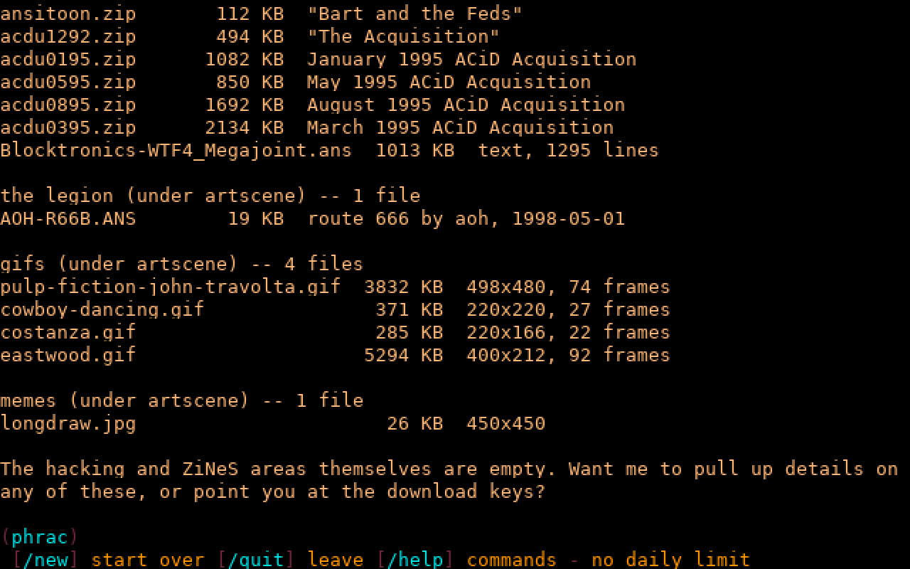

# Features

Everything the port does, in detail. The [README](../README.md) has the short list.

## In detail

**Connections**
- SSH (russh), including the older algorithms SyncTERM's cryptlib needs.
- Telnet: binary, server echo, window size (NAWS) and terminal type;
  Zmodem works over it.
- CP437 for BBS terminals, UTF-8 (with DOS wrap and clear behaviour)
  for everything else; aixterm bright colours and iCE backgrounds; 256
  and 24-bit colour art passes through.
- Nodes, with who's online, node messages, broadcasts and multinode chat.
- Paging the SysOp (`CP`, `>C` from the matrix): the page goes to a node
  where a SysOp is logged in, who is asked, wherever they are, whether
  to chat; the two then chat on the split screen (CHATMODE.ANS), each
  keystroke sent as it's typed. `/q` ends it, `/bye` from the SysOp
  hangs the caller up, `/cls` clears the windows, `/?` shows CHATHELP. Chat hours, the
  override ACS and password, pages per call and how long a page lasts
  are `[chat]` in `iniquity.toml`; outside the hours, or with no SysOp
  online, the caller is offered email instead.

**Keeping bots out**
- Key-combination bot check before anything else, on SSH and telnet.
- Per-address connection limits, bans for repeated failures (doubling,
  up to a day), allow and deny lists, a short idle limit before login.
- Bans and failures are kept in the database: bans survive a restart,
  SysOps are told at logon how many failures and bans there have been
  since their last call, `*G` lists them and lifts bans, and
  `iniquity unban ADDRESS|all` does so from the shell for a SysOp
  locked out of their own board.

**The board**
- Display engine: `|XX` colours and controls, `%XX` MCI codes, `@`/`&`
  positioning, `{`/`}` limits and padding, `~XX` fields, repeat screens
  (TOP/MID/HIL/BOT), random and day-of-week screen variants.
- Menu engine: hot keys, `/` and `//` commands, `#` (an area number
  typed at the prompt, for `M#`/`F#`), FIRSTCMD, stacked
  commands, gosub/return, generic and lightbar menus, ACS expressions,
  passwords, fallbacks, command help.
- Logon: the matrix menu, login, system password, new-user application
  (each personal question can be switched off; handles kept as typed;
  the NEWCFG screen to check the entries afterwards), access levels and
  daily limits. Every N calls the caller is asked their birth date or
  the last four digits of their phone number again (`*C`, Access and
  Logon; the manual's "calls before check" options, whose code isn't in
  the surviving source).
- Messages: areas and conferences, the reader, posting and replying,
  quoting, the full-screen editor, newscans and mandatory messages,
  email, auto-signatures. A file can be attached to a message (ACS per
  public/email in `*C`; nothing in this release's source called
  ATTACH.PAS, so this follows the manual): uploaded after posting, or
  named on disk by a SysOp, kept under `data/attach` by the message's
  row id, offered for download when the message is read, and removed
  when packing drops the message. A prepared message can be uploaded
  instead of typed (ACS and "ask" toggles in `*C`); it lands in the
  editor to look over. Email tags: `E/ n` tags the email written
  this call, `E\ n` with `E+` shows only email tagged `n` (`E-` shows
  it all), e.g. for a separate support mailbox; this release kept the
  tag on messages but never used it, so this follows the manual.
- Files: areas and conferences, the lightbar file lister, downloads
  (single and batch, with points, ratios and daily limits), uploads
  (blind or named, with FILE_ID.DIZ import, or for a single piece of
  art, alone or alone in a ZIP, a description from its SAUCE: title,
  artist/group and date, comments), search and newscan, local upload.
  Browsing (`FW`, L on the file menu; new) works like the art gallery
  over the file areas: areas are folders (with their file counts and
  newest upload), archives (ZIP, tar, tar.gz) open as folders in place,
  and Enter shows a file: text and ANSI in the viewer, pictures as ANSI
  (animated GIFs play); D downloads, with the area's usual checks. `FV`
  opens an archive the same way. Names are shown whole, sizes as
  "4.5 KB", and typed names keep their case. Zmodem built in; other protocols and archivers
  (RAR, 7Z, LHA via bsdtar/7-Zip) are external programs. Before a
  download the caller can ask to be logged off when it's done (a
  countdown afterwards; `*C`, Transfers).
  Uploads are tested on the FILETEST screen (`*C`, Upload Tests): ZIPs
  are read through (a CRC failure refuses the file) and can be held to
  an age limit; an outside command can be run on every upload in place
  of the DOS virus scanner (`clamscan --no-summary %F`, say); files on
  the delete list (BBS ads) are stripped from ZIPs and the archive
  comment added.
- Oneliners, the automessage, last callers, history and statistics, the
  BBS list, user configuration, user listing.
- Infoforms (questionnaires, mandatory or not) and new user voting.
- The time bank (`!D`/`!W` minutes, `!E`/`!I` download kilobytes, `!V`
  the account), with per-level limits on what's kept and moved each
  day (`*L`). The stock TIMEBANK menu's withdraw entry had no command;
  it's `!W` now.
- Screen themes (the original's text libraries): directories of screens
  that replace the stock ones; callers pick theirs with `UT`.
- Scripting in Lua, in place of IPL: `-X name` and `%!name` run
  `scripts/name.lua`, with a `bbs` API for output, input, the user
  record, menu commands and stored values. See
  [SCRIPTING.md](SCRIPTING.md).
- QWK offline mail: `QD` packs new messages (email as conference 0)
  for an offline reader, `QU` posts the replies (`[qwk]` in
  `iniquity.toml`). See [QWK offline mail](#qwk-offline-mail).
- Doors, native and DOS (in the built-in DOS machine): `D1` DORINFO1.DEF, `D2` DOOR.SYS,
  `D3` CHAIN.TXT, `D4` DOOR32.SYS, `DZ` DOOR.SYS and DORINFO1.DEF, `D0`
  none. See [DOORS.md](DOORS.md).

**SysOp tools** (the `*` commands on the SysOp menu)
- `*C` system configuration, written back to `iniquity.toml` keeping its
  comments; `*E` prompt strings; `*#` menus; `*L` access levels.
- `*U` users (with colours, preferences, auto-signature, infoforms).
- `*F` file areas, `*Y` files (validate, move, extract/apply DIZ), `*S`
  sort areas, `*>` download any file, `*%` local upload, `*K` pack file
  areas (forget files missing from their directories; also
  `iniquity pack-files` from the shell, as FILEPACK.EXE was).
- `*A` message areas, `*P` pack them, `*@`/`*!` conferences, `*R` all
  email.
- `*X` protocols, `*Z` archivers, `*B` BBS list, `*H` statistics, `*I`
  infoforms, `*T` themes.
- The waiting-for-caller screen (WAIT4CAL, ANSIWFCS), with `--wfc`:
  the original's screen on the console while the server runs. F1-F8
  (or 1-8) and the arrow keys pick from six pages of commands: local
  logon, a shell, the SysOp editors (run as user #1, the SysOp), launch
  a menu, read or view email, edit a text file, and stats pages (system,
  totals, today, last callers). The node and event fields show callers
  on and the next event; the window that echoed the modem shows the log
  (all of it goes to `data/iniquity.log`). ESC exits unless `[wfc]
  esc_to_exit` is off; `*C` has the settings. Modem commands, modem setup
  and MicroDOS are left out. WAIT4CAL.PAS is damaged, so the stats pages
  are rebuilt from their titles and fragments.
- `*G` security: current bans and recent failed logins and bot checks;
  lift a ban.
- `*V` events: jobs run once a day at a set time, by one scheduler in
  the server (no per-node events or modem off-hook any more). A command
  goes to the shell, or is one of the built-in jobs `pack-messages` and
  `pack-files`; `force` disconnects callers first (with the stock
  "event initiating NOW" string), `run_missed` catches up after
  downtime the same day. "Run it now" in the editor starts one by hand.

**Importing** an existing install: users (passwords re-hashed with
argon2), message bases, file records and descriptions, areas,
conferences, levels, strings, menus, text files, statistics, history,
callers, BBS list, infoforms and their answers, new user votes, text
libraries (unpacked into themes).

## QWK offline mail

`QD` builds NAME.QWK (`[qwk] packet`) from the new messages in the
caller's areas (the current conference's, or every conference's) and
their new email, and sends it; once it's down, the newscan pointers can
move past what was packed. `QU` takes NAME.REP back (a SysOp can give a
local file instead) and posts the replies where the caller may post;
the same packet won't post twice.

Changes from the original: email goes in as conference 0, with
PERSONAL.NDX; "include your own messages?" does what it says (the
original's test was the wrong way round); four-digit years; areas with
a password are left out; pointers move to the newest message packed
rather than to the time of the download; long reply lines are wrapped
rather than cut at 79 columns; and replies to unknown users are refused
in email (posted to the name in public areas, as before).

## Infoforms and new user voting

An infoform is a text file in `text/` with input points in it (see
`text/EXAMPLE.INF`): `~SN` reads text (`~SU` upper case, `~SM` mixed,
`~SC` first letter up, and the r5 `~SE ~SW ~SI` styles), `~BD` a date,
`~PN` a phone number, `~NM` digits, `~FN` a filename, and a bare `*` is
plain text too. `~NN` (two digits) sets how long answers may be, `~**`
puts it back to 254, and `~*=` / `~*-` make them required or optional.
Mandatory forms are filled in at logon (`IM` on the stock STARTUP menu);
callers see and redo theirs with `IN`.

With new user voting (`[nuv]`), users who pass the voter ACS vote on the
users who match the candidate ACS, at logon or from the main menu.
Voters can read the candidate's NUV infoforms and leave comments; enough
yes votes give the candidate the validated level, enough no votes delete
them.

## AI chat

New: `AI` (J on the main menu) is a chat with a language model, for
callers the SysOp lets in. `[ai] acs` is `s250|fI` as stock: SysOps,
and anyone given flag I in the user editor (`*U`). It talks to any
OpenAI-style chat completions server (`base_url` up to `/v1`, `model`,
and `api_key_env` naming an environment variable with a key, if the
server needs one), streams replies as they're written, word-wrapped and
without markdown or the model's thinking, and keeps the conversation for
as long as the caller stays (`/new` starts over, `/quit` or ESC leaves).
With `web_search` on, the model may search the web, up to four times a
reply: through a SearXNG instance (`search_url`), else the Brave Search
API (`search_key_env`), else DuckDuckGo's HTML page, which turns away
bots now and then. With `read_pages` on too, it may read a page it
found (as text, at most 8000 characters), but only from public
addresses: never the board itself, the LAN or the tailnet. It can always
look at the board itself (`aiboard.rs`): the menus with their keys and
where they lead, the file and message areas, and the files in them
(listed or searched), all as the caller's own access allows, so it can
say what's here and which keys to press. `daily_limit` caps a caller's messages a day (not
the SysOp's); `name`, `system_prompt`, `max_tokens`, `reasoning_effort`
and `timeout_seconds` do what they say. All of it is under "AI Chat" in
`*C`.

## Not planned

Tetris (`TP`, `TS`; the game's source isn't in this
release, `tetris.pas` being a misnamed terminal unit), modem setup
(`*M`), MicroDOS (`*D`, a shell on the host),
the local console's status bar (STATBAR), and the Oblivion/Renegade
converters (OBV2INIQ, REN2INIQ).
